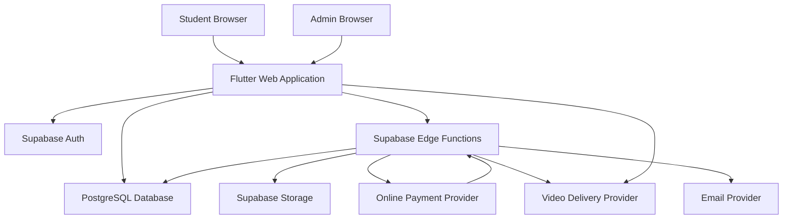
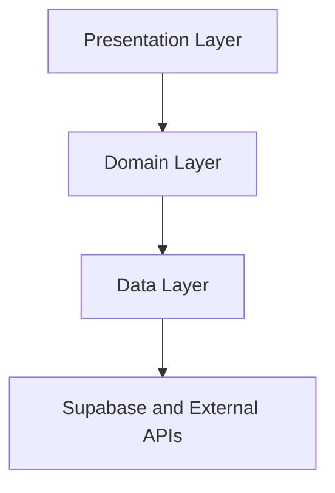
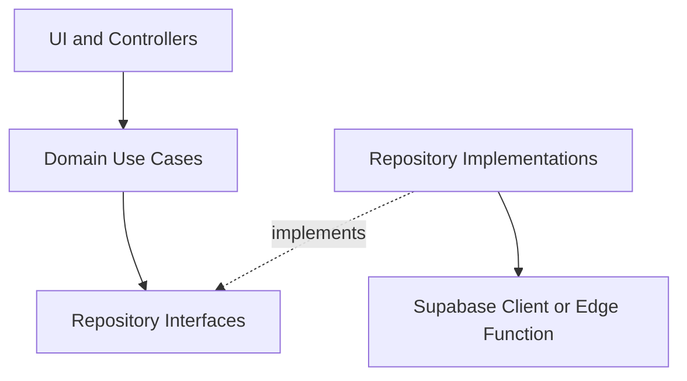
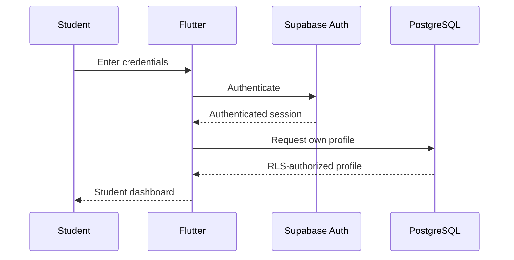
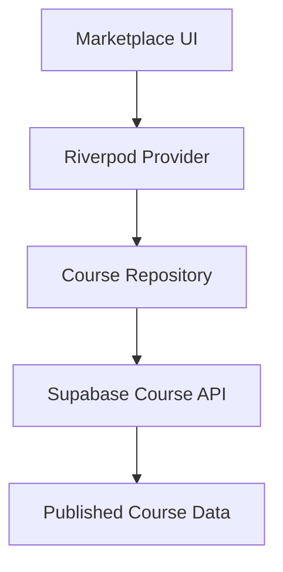
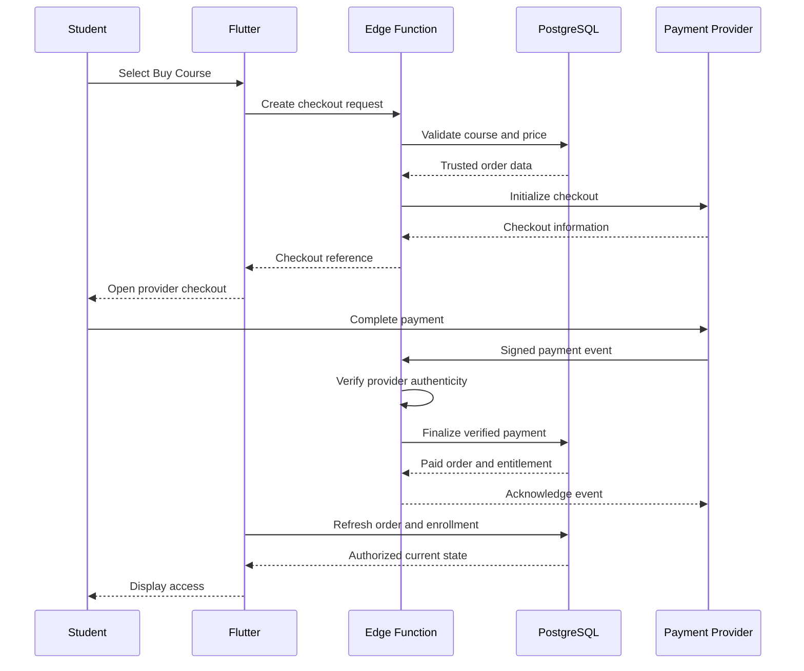
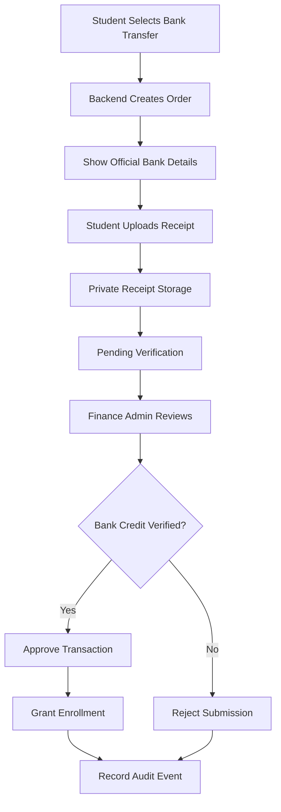
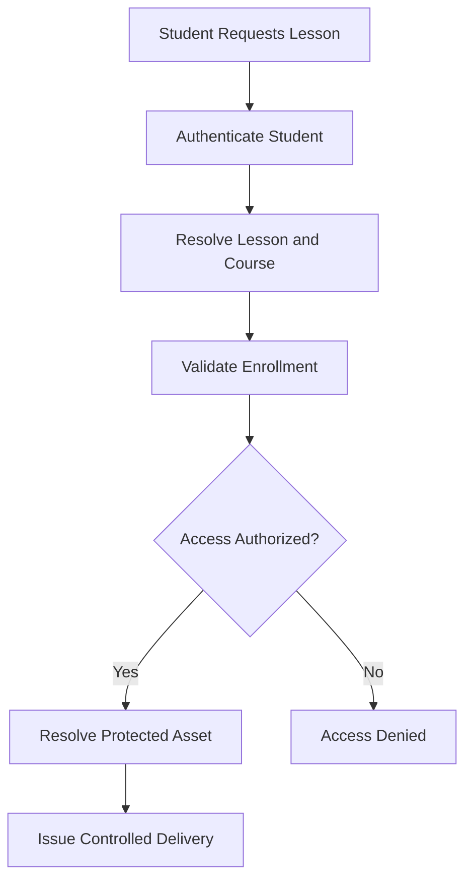

# ARCHITECTURE.md
# Acedra - Software and System Architecture

Document ID: CSA-ARCH-001
Version: 2.1
Status: Approved Baseline - Implementation and Operational Gates Retained
Project: Acedra Course Selling Application
Product Type: Commercial E-Learning Platform

Review date: 2026-10-11
Approval evidence: [CSA-007 architecture review](docs/requirements/CSA-007-ARCHITECTURE.md).
Approved SRS 1.1 and CSA-003..005 policies govern existing decisions. New
[enrollment/refund](docs/requirements/CSA-006-ENROLLMENT-REFUNDS.md),
[database](docs/requirements/CSA-008-DATABASE.md) and
[PDF delivery](docs/requirements/CSA-010-PDF-DELIVERY.md) baselines were accepted by the owner on 2026-10-11 through the review-and-merge
instruction. Runtime and unspecified operational values remain downstream gates.

Primary Platform: Flutter Web
Future Platforms: Android and iOS

Frontend:
Flutter + Dart + Material 3

State Management:
Riverpod

Navigation:
go_router

Backend:
Supabase

Database:
PostgreSQL

Authentication:
Supabase Auth

Authorization:
PostgreSQL RLS + Trusted Backend

File Storage:
Supabase Storage

Backend Functions:
Supabase Edge Functions

Architecture Style:
Modular Monolith
Feature-First Clean Architecture

Development:
Claude Code + OpenAI Codex

Coordination:
GitHub + Git Worktrees + Pull Requests

Classification:
Internal Engineering Documentation

---

# 1. PURPOSE

This document defines the proposed
software architecture for Acedra.

Acedra is a commercial application
for selling and delivering digital courses.

The system must support:

- Student registration and login
- Course discovery
- Course search and filtering
- Course details and previews
- Online course payments
- Bank transfer payments
- Bank receipt submission
- Administrator payment verification
- Secure enrollment management
- Video lessons
- PDF lessons
- Image lessons
- Text lessons
- Learning progress tracking
- Protected course content
- Course management
- Student administration
- Financial administration
- Reporting and auditing

The architecture must provide:

1. Security
2. Correctness
3. Maintainability
4. Scalability
5. Testability
6. Performance
7. Accessibility
8. Reliability
9. Privacy
10. Cost Efficiency

The project will use coordinated
parallel development involving
Claude Code and OpenAI Codex.

This document serves as a shared
technical contract for both agents.

---

# 2. RELATED DOCUMENTS

All architectural decisions must
remain consistent with:

- AGENTS.md
- CLAUDE.md
- PLAN.md
- TASKS.md
- SRS.md
- DATABASE_DESIGN.md
- DESIGN_SYSTEM.md
- SECURITY.md
- CONTRIBUTING.md
- docs/TESTING.md
- docs/PARALLEL_WORKFLOW.md
- docs/API_CONTRACTS.MD

Document responsibilities:

SRS.md:
Defines product requirements.

ARCHITECTURE.md:
Defines components and interactions.

DATABASE_DESIGN.md:
Defines data structures and permissions.

DESIGN_SYSTEM.md:
Defines UI/UX standards.

SECURITY.md:
Defines security controls.

TASKS.md:
Defines implementation tasks.

AGENTS.md:
Defines agent engineering behavior.

PARALLEL_WORKFLOW.md:
Defines multi-agent coordination.

API_CONTRACTS.md:
Defines shared service interfaces.

Missing documents must not
be treated as completed or approved.

---

# 3. ARCHITECTURAL PRINCIPLES

All development must follow:

SOLID

DRY

KISS

YAGNI

SEPARATION OF CONCERNS

SINGLE RESPONSIBILITY

DEPENDENCY INVERSION

DEFENSE IN DEPTH

LEAST PRIVILEGE

SECURITY BY DESIGN

PRIVACY BY DESIGN

TESTABILITY

EXPLICIT ERROR HANDLING

CONTROLLED STATE TRANSITIONS

## Mandatory Rules

- Prefer simple maintainable components.
- Keep business logic separate from UI.
- Keep financial authority server-side.
- Never trust client-supplied permissions.
- Use typed application models.
- Validate inputs at trust boundaries.
- Enforce database access restrictions.
- Make sensitive operations auditable.
- Design critical operations to be idempotent.
- Test authorization failures.
- Avoid unnecessary infrastructure complexity.

Do not introduce microservices
unless justified by approved requirements.

---

# 4. ARCHITECTURAL DECISION SUMMARY

## ADR-001 - Primary Frontend

Decision:
Flutter Web.

Reason:
Cross-platform code reuse and
responsive application development.

Status:
Proposed baseline.

## ADR-002 - Frontend Architecture

Decision:
Feature-First Clean Architecture.

Reason:
Maintainable feature boundaries
and independent testing.

Status:
Proposed baseline.

## ADR-003 - State Management

Decision:
Riverpod.

Status:
Proposed baseline.

## ADR-004 - Navigation

Decision:
go_router.

Status:
Proposed baseline.

## ADR-005 - Backend

Decision:
Supabase.

Status:
Proposed baseline.

## ADR-006 - Database

Decision:
PostgreSQL with Row Level Security.

Status:
Proposed baseline.

## ADR-007 - Trusted Financial Operations

Decision:
Edge Functions with transactional
PostgreSQL finalization.

Status:
Mandatory architectural requirement.

## ADR-008 - Private Course Media

Decision:
Private storage with entitlement-based
authorization.

Status:
Mandatory architectural requirement.

## ADR-009 - PDF Delivery

Decision:
Authenticated proxy delivery of private personalized derivatives; see CSA-010.
Status: Strategy accepted under CSA-010; implementation evaluation pending.

## ADR-010 - Video Delivery

Decision: Mux Basic signed 1080p VOD accepted under CSA-011 on 2026-10-11; trusted token issuance and conditional renewal/PoC gates retained.

## ADR-011 - Parallel Engineering

Decision:
Independent Claude/Codex workspaces
with GitHub coordination.

Status:
Proposed workflow.

## ADR-012 - Controlled Integration

Decision: Task-owned isolated workspaces and reviewed PR integration with
dependency-aware schema/API/frontend ordering. Status: Existing workflow baseline;
formal ADR approval remains tracked separately under CSA-016.

## External Provider Decisions

Decision:
PayHere and LKR are selected under approved CSA-004. Video, email, hosting and
monitoring providers require their separate decisions.

Status:
Pending.

Approved ADRs must be maintained
in docs/decisions/.

---

# 5. SYSTEM ARCHITECTURE OVERVIEW



The diagram shows logical connections.

It does not imply that every database
table is directly accessible
from the frontend.

Client database operations must
be explicitly authorized by grants and RLS.

Privileged operations use
trusted backend functions.

---

# 6. ARCHITECTURE STYLE

Acedra will use a Modular Monolith.

The system consists of one logical
application with separated features.

Main modules:

- Authentication
- User Profiles
- Marketplace
- Course Management
- Checkout
- Online Payments
- Bank Transfers
- Enrollments
- Learning
- PDF Reader
- Video Player
- Administration
- Notifications
- Reporting

Each module has:

- Clear responsibilities
- Defined dependencies
- Stable service contracts
- Independent tests
- Controlled shared resources

Modules may share the same
PostgreSQL database.

However, feature boundaries must
remain explicit.

Avoid creating distributed services
for functionality that can remain
inside the approved backend architecture.

---

# 7. TRUST BOUNDARIES

The architecture contains four
important trust boundaries.

## Boundary A - Browser

Flutter Web executes in an
untrusted client environment.

The user may inspect or modify:

- JavaScript execution
- Browser requests
- Local application state
- Client-side data
- Network traffic
- Displayed UI

Therefore:

Never trust the browser for
security-sensitive decisions.

## Boundary B - Supabase API

Supabase services authenticate
requests and enforce configured
database/storage policies.

Every exposed operation must have
an approved permission model.

## Boundary C - Trusted Backend

Edge Functions and restricted
database functions implement
privileged business operations.

Examples:

- Order creation
- Payment verification
- Bank approval
- Enrollment grants
- Role assignments
- Protected content authorization

## Boundary D - External Providers

Payment, email and video providers
have their own credentials and
security models.

Incoming provider data must be
validated before affecting
authoritative application state.

---

# 8. AUTHORITY MODEL

The frontend is responsible for:

- Displaying information
- Collecting user input
- Navigation
- Presentation state
- User feedback
- Rendering authorized content

The backend is responsible for:

- Validating identities
- Validating permissions
- Determining trusted prices
- Verifying payments
- Approving bank transfers
- Granting enrollments
- Revoking access
- Authorizing protected content
- Auditing sensitive operations

The database is responsible for:

- Persistent records
- Referential integrity
- Constraints
- Unique business invariants
- Transactional updates
- RLS enforcement
- Trusted state consistency

Critical Rule:

Frontend success does not
equal backend authorization.

---

# 9. FRONTEND TECHNOLOGY ARCHITECTURE

Technology:

Flutter

Language:

Dart

UI Framework:

Material 3

State Management:

Riverpod

Navigation:

go_router

## Frontend Responsibilities

- Screen rendering
- Responsive layouts
- User interactions
- Authentication presentation
- Marketplace browsing
- Checkout presentation
- Learning navigation
- PDF reading
- Video playback controls
- Administration interfaces

## Frontend Restrictions

Never:

- Store privileged API keys.
- Approve payments.
- Directly activate paid enrollments.
- Trust client roles for backend authorization.
- Expose protected file URLs permanently.
- Treat route guards as data security.
- Modify authoritative financial state.

---

# 10. FRONTEND LAYERED ARCHITECTURE

Each feature follows three
pragmatic architectural layers.



Arrows above show request flow.

Dependency direction must be
controlled through interfaces.
Compile-time imports are presentation -> domain and data -> domain; data also
imports SDK adapters. Domain never imports concrete data implementations.
Application composition wires implementations into domain contracts. Features
consume other features' domain interfaces without importing presentation/data
internals; shared dependencies must remain acyclic.

## 10.1 Presentation Layer

Contains:

- Screens
- Widgets
- Riverpod providers
- View models/controllers
- UI state
- Navigation integration

Does not contain trusted
financial business decisions.

## 10.2 Domain Layer

Contains:

- Business entities
- Repository contracts
- Domain validation
- Use cases where necessary
- Application error models

Should remain testable
without Flutter widgets.

## 10.3 Data Layer

Contains:

- Repository implementations
- Supabase client adapters
- Data transfer objects
- Serialization
- Remote data sources
- Approved caching adapters

Business-sensitive server decisions
must not be reimplemented as
authoritative frontend rules.

---

# 11. RECOMMENDED FLUTTER STRUCTURE

Target structure:

```text
lib/
├── main.dart
│
├── app/
│   ├── app.dart
│   ├── bootstrap.dart
│   │
│   ├── router/
│   │   ├── app_router.dart
│   │   └── route_names.dart
│   │
│   ├── theme/
│   │   ├── app_theme.dart
│   │   ├── app_colors.dart
│   │   ├── app_typography.dart
│   │   └── app_spacing.dart
│   │
│   └── layout/
│       ├── public_shell.dart
│       ├── student_shell.dart
│       ├── learning_shell.dart
│       └── admin_shell.dart
│
├── core/
│   ├── config/
│   ├── constants/
│   ├── errors/
│   ├── security/
│   ├── networking/
│   ├── utils/
│   └── widgets/
│
└── features/
    ├── authentication/
    ├── profile/
    ├── marketplace/
    ├── courses/
    ├── checkout/
    ├── payments/
    ├── bank_transfers/
    ├── enrollments/
    ├── learning/
    ├── pdf_reader/
    ├── video_player/
    ├── admin/
    └── notifications/
```

This is a target structure,
not a claim that files exist.

Avoid creating empty layers
without a real architectural need.

---

# 12. FEATURE MODULE STRUCTURE

Example:

```text
features/
  marketplace/
    presentation/
      screens/
      widgets/
      providers/

    domain/
      entities/
      repositories/
      usecases/

    data/
      models/
      datasources/
      repositories/
```

## Module Rules

- Separate unrelated features.
- Avoid circular dependencies.
- Share UI through approved components.
- Share technical utilities through core.
- Avoid placing feature business logic
  into global utility classes.
- Prefer dependency injection.
- Keep repository contracts stable.

Use simple structures for small features.

Do not add unnecessary abstraction layers.

---

# 13. DEPENDENCY DIRECTION

Presentation depends on
domain contracts and use cases.

Data implementations satisfy
domain repository contracts.

The application composition layer
connects interfaces to implementations.

Preferred conceptual structure:



Widgets must not directly perform
privileged payment mutations.

Business rules should be
independently testable where practical.

---

# 14. STATE MANAGEMENT

Use Riverpod for application state.

State categories:

## Authentication State

Current user
Current session
Authentication status

## Marketplace State

Course listings
Filters
Search query
Pagination

## Checkout State

Selected course
Order summary
Payment method
Checkout request state

## Learning State

Current lesson
Authorized course
Learning progress
Reader position

## Admin State

Course management
Student management
Payment review queue
Reports

## State Rules

- Keep local widget state local.
- Avoid redundant global state.
- Use immutable models where practical.
- Handle loading and errors explicitly.
- Invalidate affected cached queries.
- Clear sensitive state on logout.
- Prevent stale state from granting access.

Server state is authoritative
for orders and enrollments.

---

# 15. NAVIGATION ARCHITECTURE

Use go_router.

Main navigation areas:

PUBLIC
AUTHENTICATION
STUDENT
CHECKOUT
LEARNING
ADMIN

## Proposed Routes

Public:

/
 /courses
 /courses/:slug
 /categories/:slug

Authentication:

/login
/register
/forgot-password
/reset-password

Student:

/dashboard
/my-courses
/orders
/profile
/settings

Checkout:

/checkout/:courseId
/checkout/:courseId/bank-transfer
/orders/:orderId/status

Learning:

/learn/:courseId
/learn/:courseId/lessons/:lessonId
/reader/:lessonId

Admin:

/admin
/admin/courses
/admin/courses/new
/admin/courses/:courseId/edit
/admin/students
/admin/orders
/admin/bank-transfers
/admin/reports
/admin/settings

## Navigation Rules

- Support responsive navigation.
- Preserve browser back behavior.
- Handle deep links safely.
- Redirect unauthenticated users appropriately.
- Display access denied when required.
- Do not rely on hidden routes for security.

Backend authorization remains mandatory.

---

# 16. RESPONSIVE UI ARCHITECTURE

Reference breakpoints:

Compact:
Below 600 logical pixels

Medium:
600 to 1023 logical pixels

Expanded:
1024 logical pixels and above

Reference test widths:

390
768
1440

## Navigation Patterns

Compact:

- Bottom navigation where appropriate
- Drawer navigation
- Single-column content
- Full-width primary actions

Medium:

- Adaptive navigation rail
- Two-column layouts where useful
- Responsive panels

Expanded:

- Sidebar navigation
- Multi-column catalog
- Persistent admin navigation
- Wider learning layouts

## Design Rules

Follow DESIGN_SYSTEM.md.

Use consistent:

- Colors
- Typography
- Spacing
- Radius
- Elevation
- Components
- Interaction states

Accessibility is required
at every supported layout size.

---

# 17. BACKEND ARCHITECTURE

The Supabase backend consists of:

1. Supabase Auth
2. PostgreSQL
3. Row Level Security
4. Supabase Storage
5. Edge Functions
6. Restricted database functions
7. External service integrations

## Direct Database Access

Use direct client access only
for operations safely controlled
by grants and RLS.

Examples:

- Published course listing
- Own profile reading
- Own order status reading
- Own enrollment listing
- Approved learning progress operations

## Trusted Backend Access

Use Edge Functions and restricted
database operations for:

- Creating authoritative orders
- Initializing payment checkout
- Processing provider callbacks
- Approving bank transfers
- Granting enrollments
- Assigning privileged roles
- Publishing restricted content
- Authorizing sensitive media delivery

Never expose unrestricted
service credentials to the frontend.

---

# 18. DATABASE ARCHITECTURE

Primary database:

PostgreSQL

Managed by:

Supabase

Primary schemas:

auth
public
app_private
storage

## Schema Roles

auth:

Supabase-managed user identity.

public:

Application records with
carefully controlled API permissions.

app_private:

Sensitive internal application records.

storage:

Supabase-managed storage metadata.

## Key Entity Groups

Identity:

profiles
roles
user_roles
course_staff

Marketplace:

categories
courses
course_sections
lessons

Media:

lesson_content
media_assets
lesson_assets

Commerce:

orders
payment_attempts
payment_events
bank_transfer_submissions
bank_review_records

Learning:

enrollments
enrollment_grants
lesson_progress
lesson_bookmarks

Operations:

audit_logs
notification_outbox
idempotency_records

The full schema is specified
in DATABASE_DESIGN.md.

---

# 19. DATABASE ACCESS STRATEGY

Use explicit access policies.

## Public Data

Examples:

- Published course titles
- Published descriptions
- Course thumbnails
- Published curriculum metadata
- Public previews

## Student-Private Data

Examples:

- Profile
- Orders
- Enrollments
- Learning progress
- Bookmarks

## Administrative Data

Examples:

- Bank receipts
- Financial review records
- Admin role assignments
- Restricted audit records
- Unpublished course data

## Protected Course Content

Examples:

- Paid lesson body
- Private PDF assets
- Paid lesson images
- Protected video playback information

Do not expose protected content
through publicly readable tables.

---

# 20. ROW LEVEL SECURITY

RLS is mandatory on protected
tables exposed through database APIs.

## RLS Requirements

- Enable RLS.
- Review table grants.
- Define operation-specific policies.
- Test anonymous access.
- Test authenticated access.
- Test row ownership.
- Test cross-student isolation.
- Test administrative permissions.

RLS and SQL privileges are
separate controls.

Both must be configured correctly.

## Important Restrictions

Never:

- Disable RLS to resolve a bug.
- Grant unrestricted table access.
- Trust client-editable roles.
- Use an unsafe privileged view.
- Assume a UI restriction secures the data.

Database views require review
for security-invoker behavior
and underlying table permissions.

---

# 21. AUTHENTICATION ARCHITECTURE

Identity provider:

Supabase Auth

Supported MVP operations:

- Registration
- Email verification
- Login
- Logout
- Password recovery
- Session restoration
- Profile management

## Authentication Flow



## Session Rules

- Use supported Supabase Auth flows.
- Do not implement custom password storage.
- Do not log session tokens.
- Handle expired sessions.
- Clear sensitive UI state after logout.
- Avoid exposing privileged credentials.

Session persistence must be
reviewed for web security.

---

# 22. ROLE-BASED ACCESS CONTROL

Application roles:

GUEST

STUDENT

CONTENT_MANAGER

FINANCE_ADMIN

SUPER_ADMIN

Guest represents an
unauthenticated visitor.

## Guest

May:

- Browse published courses
- View public course details
- View approved previews
- Register and log in

## Student

May:

- Manage own profile
- Create checkout requests
- Submit own bank receipts
- Read own order status
- Access valid purchased courses
- Save own learning progress

## Content Manager

May:

- Manage assigned courses
- Manage curriculum
- Upload approved lesson assets
- Author drafts only; publication/unpublication/archive and price changes
  require super-admin authority under the approved CSA-003 matrix

## Finance Admin

May:

- Review permitted payment records
- Verify bank settlements
- Approve or reject submissions
- Access necessary financial reports

## Super Admin

May perform explicitly
authorized platform administration.

## Important

Role checks must run on
trusted backend boundaries.

Frontend role checks only
control navigation and presentation.

Role assignments must not be
directly editable by students.

---

# 23. COURSE MARKETPLACE ARCHITECTURE

Marketplace responsibilities:

- Course discovery
- Category listing
- Search
- Filtering
- Course details
- Public curriculum preview
- Pricing display
- Enrollment-aware presentation

## Data Flow



## Important

The marketplace may display
publicly available metadata.

It must not expose:

- Private PDF paths
- Paid lesson text
- Protected video credentials
- Admin-only draft content

Use pagination for large catalogs.

---

# 24. COURSE MANAGEMENT ARCHITECTURE

Content management operations:

- Create course
- Edit metadata
- Set pricing
- Create sections
- Create lessons
- Upload media
- Reorder curriculum
- Publish course
- Archive course

## Publishing Requirements

A publish operation should verify:

- Current authorized super admin, with required production MFA
- Valid course metadata
- Valid currency and price
- Required course fields
- Curriculum consistency
- Asset availability
- Approved visibility rules

## Content Publication

Draft course data remains protected.

Public access is enabled only
through an approved publication state.

Do not allow students to obtain
draft lesson content through
direct database requests.

---

# 25. ONLINE PAYMENT ARCHITECTURE

Payment provider:

PayHere; primary billing currency LKR. Merchant activation, domain setup,
sandbox verification and release readiness remain unverified.

The architecture must support
an authenticated checkout
and trusted provider confirmation.

## High-Level Payment Flow



The provider callback must
be independently verified.

A payment redirect must never
be treated as proof of payment.

---

# 26. PAYMENT VERIFICATION REQUIREMENTS

The backend must verify:

- Provider authenticity
- Payment transaction reference
- Order reference
- Amount
- Currency
- Provider-reported outcome
- Transaction ownership
- Duplicate event processing state

## Important

The client must never be able
to create a paid order by
updating a status field.

The client must not decide
whether a payment succeeded.

## Financial State

The database is authoritative.

An order becomes paid only through
an approved trusted operation.

Every successful financial finalization
must preserve enrollment consistency.

---

# 27. PROVIDER WEBHOOK SECURITY

External payment providers may not
send Supabase user JWTs.

An external webhook may therefore
require an endpoint that accepts
requests without Supabase JWT validation.

However:

That does NOT make its payload trusted.

## Required Webhook Processing

1. Read the provider request correctly.
2. Verify cryptographic signature
   or provider-approved authentication.
3. Validate timestamp/replay protections
   where supported.
4. Validate provider event identity.
5. Resolve trusted payment attempt.
6. Compare expected amount/currency.
7. Check current state.
8. Apply idempotent transaction.
9. Record safe audit metadata.
10. Acknowledge according to provider rules.

## Security Rules

- Verify signature before trusting event data.
- Preserve raw request bytes if required
  by the provider signature scheme.
- Do not log signing secrets.
- Do not trust arbitrary callback bodies.
- Do not accept duplicated settlement effects.
- Do not allow older failure events
  to reverse a valid paid state.

Webhook implementations depend on
the chosen provider's official protocol.

---

# 28. FINANCIAL TRANSACTION BOUNDARY

Financial finalization must use
a trusted atomic database operation.

Conceptual transaction:

BEGIN TRANSACTION

- Lock relevant order/payment records.
- Verify expected state.
- Verify event has not been processed.
- Record verified event.
- Finalize payment attempt.
- Mark order as paid.
- Create or update entitlement.
- Record grant source.
- Write audit record.
- Queue notification.

COMMIT TRANSACTION

If any required database step fails:

ROLLBACK TRANSACTION

## Technical Rule

A single Edge Function may orchestrate
the operation.

However, separate independent
database API requests do not
automatically form one transaction.

Use an approved transactional
PostgreSQL function or equivalent
trusted transaction boundary.

External provider calls are outside
the PostgreSQL transaction.

Use reconciliation for failures
between external and internal systems.

---

# 29. PAYMENT IDEMPOTENCY

Payment callbacks may be:

- Duplicated
- Delayed
- Retried
- Received out of order
- Delivered concurrently

The database must safely handle
these scenarios.

## Required Protections

- Verified provider event uniqueness
- Payment transaction uniqueness
- Conditional state transitions
- Appropriate database locks
- Unique enrollment grant sources
- Transactional updates

A repeated valid payment event
must not grant multiple unintended
enrollments.

A failed event must not downgrade
an already verified paid order.

---

# 30. BANK TRANSFER ARCHITECTURE

Bank transfers require
manual financial verification.

## Process



## Critical Rule

Receipt uploaded does not
mean money has arrived.

An authorized finance administrator
must independently confirm
the actual bank settlement.

The backend must not automatically
approve uploaded receipts.

---

# 31. BANK TRANSFER SECURITY

The approved CSA-005 policy governs 5 MiB JPEG/PNG/PDF private validation,
independent exact credit verification, no self-approval, immutable resubmission,
settlement non-reuse and one fulfillment across competing payment channels.
Receipt viewing exposes only owner-safe evidence and authorized finance records.

Requirements:

- Private storage
- Authenticated submission
- Ownership validation
- File type validation
- File size limits
- Restricted administrative access
- Review history
- Auditable decisions
- Transactional approval
- Concurrency protection

## Receipt Handling

The student may view
their own submission status.

Finance administrators may view
authorized receipts.

Other students must never
access those receipts.

## Approval Invariant

Only an approved, independently
verified bank settlement may
grant an enrollment.

## Rejection

Rejected records should remain
available for authorized auditing.

Resubmission must preserve
previous review history.

---

# 32. ENROLLMENT ARCHITECTURE

Owner-selected purchased access is lifetime with no scheduled expiry. Source
validity, refund window precision, disputes and scoped restrictions are specified
in the approved CSA-006 policy; CSA-008 defines the related source/lifecycle model.
Enrollment projection alone must not erase independent valid funding sources.

Enrollment provides the
authoritative course entitlement.

Suggested states:

active
expired
revoked

## Enrollment Fields

- Student identity
- Course identity
- Current access status
- Grant time
- Expiry
- Revocation state
- Grant source history

## Access Requirements

A student can access paid content
only when all conditions are satisfied:

1. User is authenticated.
2. Correct course is requested.
3. Enrollment belongs to user.
4. Enrollment is active.
5. Enrollment has not expired.
6. Enrollment is not revoked.
7. The requested lesson is authorized.

## Important

Students must never directly
create ACTIVE enrollments.

Trusted payment or authorized
admin operations create grants.

---

# 33. ENROLLMENT GRANT SOURCES

Approved grant sources:

online_payment

bank_transfer

admin_grant

## Online Payment

Requires verified provider settlement.

## Bank Transfer

Requires authorized, independently
verified financial approval.

## Admin Grant

Requires explicitly authorized
administrative action and audit.

## Consistency

Maintain a current entitlement
and immutable grant history.

A new verified purchase may
reactivate a previously revoked
entitlement only under approved policy.

Refund and revocation policies
must be finalized before launch.

---

# 34. PROTECTED CONTENT ARCHITECTURE

Protected content types:

- PDF
- Video
- Text
- Images

Every protected lesson
must pass entitlement validation.

## Authorization Flow



The client must not access
protected content solely by
knowing its storage path.

---

# 35. PDF DELIVERY ARCHITECTURE

CSA-010 recommends Option B: authenticated proxy delivery with server-applied
personalized watermark derivatives and authorization on every new request.
Strategy accepted under CSA-010; runtime/reader validation remains required.
Do not implement the alternative signed-URL examples as an approved contract.

PDF files are valuable paid assets.

Recommended components:

- Private PDF storage
- Backend content authorization
- Controlled document delivery
- PDF viewer
- Personalized watermark support
- Reading progress persistence
- Access logging where appropriate

## Possible Delivery Strategies

Option A:

Backend-authorized, short-lived
storage access.

Option B:

Backend proxy delivery with
authorization and optional
transformation/watermarking.

Option C:

Approved document-rendering
or protected delivery provider.

Final strategy requires review of:

- Security
- Cost
- PDF file size
- Range requests
- Reader compatibility
- Watermarking requirements
- Performance
- Accessibility

Do not select a strategy
solely because it appears
to hide the original file URL.

---

# 36. PDF READER ARCHITECTURE

The PDF reader must support:

- Page navigation
- Zoom
- Fit-to-width
- Comfortable scrolling
- Page position persistence
- Loading state
- Error state
- Responsive reader toolbar
- Keyboard interaction
- Accessible controls

Candidate package:

pdfrx

Status:
Candidate pending compatibility evaluation.

## Reader Structure

PDF Reader Screen
    |
    v
PDF Reader Controller
    |
    v
Authorized Content Repository
    |
    v
Protected Content Backend
    |
    v
PDF Delivery
    |
    v
PDF Renderer

The UI should not directly
decide content access.

---

# 37. SCREENSHOT AND RECORDING LIMITATIONS

Flutter Web cannot guarantee
complete prevention of:

- Screenshots
- Screen recordings
- Browser developer tools
- Authorized-user content extraction
- External camera recording

## Recommended Defensive Controls

- Protected content access
- Personalized watermarks
- Limited delivery authorization
- Private storage
- Session and entitlement checks
- Audit records where appropriate
- Clear content ownership policies

## Important

Disabling right-click or
hiding browser controls
is not strong content protection.

A watermark shown only as
a UI overlay may be removable.

If the product requires a watermark
to remain attached to the document,
apply it through an approved
trusted content transformation process.

Do not promise impossible DRM guarantees.

---

# 38. VIDEO ARCHITECTURE

Video provider:

Mux Basic signed 1080p VOD, accepted CSA-011.
See docs/decisions/CSA-011-VIDEO-PROVIDER.md; privacy, browser and five-minute
token renewal/revocation proof remains required before implementation acceptance.

Preferred capabilities:

- Protected playback
- Short-lived playback authorization
- Adaptive streaming
- Mobile-friendly playback
- Appropriate bandwidth control
- Reliable seek/resume behavior

## Video Flow

Student
    |
    v
Flutter Video Player
    |
    v
Backend Authorization
    |
    v
Protected Playback Credentials
    |
    v
Approved Video Provider

## Requirements

- Verify entitlement.
- Validate requested lesson.
- Avoid public unrestricted videos.
- Keep signing credentials server-side.
- Handle expired playback sessions.
- Save learning progress safely.

Signed playback authorization
does not eliminate screen recording.

---

# 39. TEXT AND IMAGE LESSONS

## Text Content

Possible representation:

Validated structured JSON
or approved rich-text format.

Rules:

- Store protected content separately.
- Sanitize untrusted content.
- Prevent script injection.
- Restrict access.
- Support readability.
- Support accessible semantics.

## Image Content

Rules:

- Private when paid.
- Validate upload format.
- Optimize dimensions.
- Use responsive rendering.
- Provide accessible descriptions.
- Restrict unauthorized file access.

Avoid publishing protected image URLs
inside public curriculum metadata.

---

# 40. STORAGE ARCHITECTURE

Proposed storage buckets:

course-thumbnails

course-pdfs

lesson-images

bank-receipts

Optional:

course-resources

Video assets may live in
a dedicated external provider.

## Bucket Visibility

course-thumbnails:

Public only for approved
published thumbnail assets.

course-pdfs:

Private.

lesson-images:

Private when part of paid content.

bank-receipts:

Private.

course-resources:

Private by default.

## Storage Policies

- Restrict upload permissions.
- Restrict reads.
- Restrict listing.
- Validate ownership.
- Validate bucket and object path.
- Control deletion.
- Use trusted authorization.

Storage owner metadata alone
does not automatically grant security.

Design explicit Storage policies.

---

# 41. SIGNED RESOURCE ACCESS

Signed URLs may be used
when approved for a resource.

## Requirements

- Validate student entitlement first.
- Use appropriate expiration.
- Limit asset scope.
- Avoid logging full signed URLs.
- Avoid exposing tokens in analytics.
- Avoid unnecessary client persistence.
- Review browser caching behavior.

## Important Limitation

A signed URL is a bearer capability.

A user possessing the URL may
access it until it expires
or another supported control blocks it.

Expiry cannot erase already
downloaded content.

Immediate revocation of an
already buffered document
cannot be guaranteed in the browser.

---

# 42. LEARNING PROGRESS ARCHITECTURE

Track:

- Student identity
- Lesson identity
- Last opened time
- Completion status
- PDF page
- Video progress
- Resume position

## Progress Flow

Flutter Learning UI
    |
    v
Progress Controller
    |
    v
Progress Repository
    |
    v
Authorized Data Operation
    |
    v
PostgreSQL

## Security

A student may update only
their own authorized progress.

Progress updates must not
grant course access.

## Performance

Save progress at meaningful intervals.

Avoid excessive writes during
scrolling or video playback.

Use approved throttling/debouncing.

---

# 43. ADMINISTRATION ARCHITECTURE

Main modules:

Dashboard

Course Management

Curriculum Management

Student Management

Bank Transfer Review

Orders

Enrollments

Reports

Roles

Audit Records

## Admin UI Architecture

Admin Screens
    |
    v
Admin Riverpod Providers
    |
    v
Admin Repositories
    |
    v
Trusted Admin Operations
    |
    v
PostgreSQL

## Security Rules

- Authenticate administrator.
- Validate current role.
- Validate scope of operation.
- Enforce backend authorization.
- Audit sensitive mutations.
- Restrict finance records.
- Restrict role management.

A visible Admin Dashboard
does not prove authorization.

---

# 44. AUDIT LOGGING ARCHITECTURE

Sensitive operations must
create audit records.

Examples:

payment_verified

bank_transfer_approved

bank_transfer_rejected

enrollment_granted

enrollment_revoked

course_published

admin_role_assigned

## Audit Data

- Actor
- Action
- Resource
- Timestamp
- Outcome
- Request identifier
- Minimal safe metadata

## Security

Do not log:

- Passwords
- Session tokens
- Provider secrets
- Full bank receipts
- Full signed content URLs

Critical financial audit events
should be part of the appropriate
atomic database transaction.

Audit logs must be restricted
from ordinary student modification.

---

# 45. NOTIFICATION ARCHITECTURE

Notification channels:

Email

In-app status messages

Future:

Push notifications

## Important Events

- Account verification
- Payment confirmed
- Bank receipt submitted
- Bank transfer approved
- Bank transfer rejected
- Enrollment granted
- Enrollment revoked

## Recommended Pattern

Database Transaction
    |
    v
Notification Outbox
    |
    v
Background Worker
    |
    v
Email Provider
    |
    v
Delivery Status

A financial operation must not
fail solely because an email
provider is temporarily unavailable.

## Reliability

- Use safe retries.
- Avoid duplicate notifications.
- Record delivery state.
- Respect privacy requirements.
- Do not expose sensitive details.

The outbox worker requires
an approved scheduled or
event-driven execution mechanism.

---

# 46. API ARCHITECTURE

Acedra uses two main API patterns.

## Pattern A - RLS-Protected Reads

For appropriately exposed data:

Flutter
    |
Supabase Client
    |
PostgreSQL + RLS

## Pattern B - Trusted Operations

For privileged workflows:

Flutter
    |
Edge Function
    |
Authorized Backend Logic
    |
Restricted Database Operation

## Initial Function Contracts

create-checkout-order

initialize-online-payment

payment-provider-webhook

submit-bank-transfer

approve-bank-transfer

reject-bank-transfer

authorize-course-content

grant-admin-enrollment

revoke-enrollment

publish-course

assign-user-role

Actual endpoint names and payloads
must be finalized in API_CONTRACTS.md.

Do not create several conflicting
functions for the same operation
without architectural justification.

---

# 47. API RESPONSE DESIGN

Use consistent success/error behavior.

Recommended successful response:

```json
{
  "data": {
    "id": "example-id"
  }
}
```

Recommended error response:

```json
{
  "error": {
    "code": "ACCESS_DENIED",
    "message": "You cannot access this resource."
  }
}
```

## Suggested Error Codes

AUTH_REQUIRED

ACCESS_DENIED

VALIDATION_ERROR

RESOURCE_NOT_FOUND

COURSE_UNAVAILABLE

ALREADY_ENROLLED

PAYMENT_PENDING

PAYMENT_VERIFICATION_FAILED

BANK_RECEIPT_INVALID

ENROLLMENT_REQUIRED

ENROLLMENT_EXPIRED

ENROLLMENT_REVOKED

RATE_LIMITED

CONFLICT

INTERNAL_ERROR

Final contracts must specify
HTTP status codes and payloads.

Do not expose internal stack traces
in production API responses.

---

# 48. ERROR HANDLING ARCHITECTURE

Errors must be classified.

## Validation Errors

Incorrect input.

## Authentication Errors

User session missing or invalid.

## Authorization Errors

User lacks permission.

## Business Rule Errors

Example:

Already enrolled.

## Financial Errors

Payment verification failed.

## External Provider Errors

Provider temporarily unavailable.

## Network Errors

Connection lost or timed out.

## Internal Errors

Unexpected server failure.

## Rules

- Return safe user-facing messages.
- Preserve useful server diagnostics.
- Avoid leaking private information.
- Use stable error codes.
- Handle retries carefully.
- Fail closed for privileged operations.

Never turn a payment verification
error into successful enrollment.

---

# 49. SECURITY ARCHITECTURE

Security mechanisms include:

- Supabase Auth
- PostgreSQL RLS
- Database grants
- Backend role checks
- Private Storage policies
- Restricted Edge Functions
- Payment provider verification
- Atomic financial operations
- Audit logging
- Secret management
- Input validation
- Upload validation
- Abuse prevention

## Privileged Operations

Use minimal trusted credentials.

Prefer a user-scoped database client
for normal user operations.

Use privileged backend clients
only when elevated permissions
are necessary and independently
authorized.

A service-role credential bypasses RLS
and must never reach the browser.

---

# 50. THREAT MODEL SUMMARY

## Threat: Fake Payment Success

Mitigation:

Verified backend provider confirmation.

## Threat: Duplicate Payment Callback

Mitigation:

Idempotency and transactional uniqueness.

## Threat: Forged Bank Receipt

Mitigation:

Independent bank settlement verification.

## Threat: Student Grants Own Access

Mitigation:

No direct enrollment write permission.

## Threat: Cross-Student Data Leakage

Mitigation:

RLS, grants, backend ownership checks.

## Threat: Public Paid PDF

Mitigation:

Private storage and entitlement validation.

## Threat: Unauthorized Admin Operation

Mitigation:

Trusted RBAC and audit.

## Threat: Malicious File Upload

Mitigation:

File validation, access restrictions,
and approved content scanning strategy.

## Threat: Secret Leakage

Mitigation:

Server-side secret storage,
restricted CI permissions,
and secret scanning.

## Threat: Browser Content Capture

Mitigation:

Watermarking and controlled delivery,
with explicit acknowledgement
that complete prevention is impossible.

---

# 51. WEB SECURITY ARCHITECTURE

Flutter Web is a browser application.

Required controls:

- HTTPS in production
- Appropriate security headers
- Safe input handling
- XSS prevention
- Strict secret separation
- Correct CORS configuration
- Approved authentication storage behavior
- Appropriate rate limiting
- Secure external integrations

Evaluate:

- Content Security Policy
- Cross-origin resource access
- Unsafe redirects
- Third-party scripts
- Dependency supply-chain risk
- Token handling
- Sensitive browser caching

CORS is not authorization.

Hiding UI controls is not authorization.

If cookie-based authentication
is introduced, assess CSRF controls.

---

# 52. PERFORMANCE ARCHITECTURE

Performance objectives:

- Fast initial application startup
- Responsive navigation
- Efficient course browsing
- Smooth PDF reading
- Stable video playback
- Efficient database queries

## Frontend Optimization

- Minimize unnecessary rebuilds.
- Load content when needed.
- Avoid excessive large images.
- Use appropriate pagination.
- Optimize Flutter Web assets.
- Avoid unnecessary startup requests.

## Backend Optimization

- Index common queries.
- Review query execution plans.
- Optimize RLS predicates.
- Avoid excessive network round trips.
- Use bounded database queries.
- Apply safe caching where appropriate.

## PDF Optimization

- Evaluate large-document rendering.
- Support efficient navigation.
- Monitor memory consumption.
- Avoid unnecessary repeated downloads.
- Ensure caching respects access policy.

Performance thresholds must be
measured and approved.

Do not invent performance results.

---

# 53. CACHE STRATEGY

Data categories require
different caching rules.

## Public Catalog

May use appropriate caching
and invalidation.

## Student Profile

Cache only within authorized
application session rules.

## Order Status

Refresh from authoritative backend
after payment-related events.

## Enrollment State

Must reflect valid current access.

## Protected Content

Avoid persistent unrestricted caching.

## Sensitive Financial Data

Do not store unnecessarily
in browser-accessible caches.

## Revocation

An enrollment revocation must
block future authorized requests.

Previously delivered content
may remain in user-controlled memory
or browser caches.

Do not claim revocation can
erase already copied content.

---

# 54. RELIABILITY ARCHITECTURE

The system must handle:

- Network failures
- Payment provider delays
- Duplicate callbacks
- Supabase availability issues
- Storage failures
- Notification failures
- Interrupted uploads
- Concurrent administrator actions

## Reliability Patterns

- Idempotency keys
- Database transactions
- Explicit timeouts
- Bounded retries
- Error classification
- Notification outbox
- Payment reconciliation
- Safe fallback UI states

## Retry Rule

Retry only when safe.

Do not blindly retry
non-idempotent financial mutations.

## Payment Reconciliation

A background or administrative
reconciliation process should
detect inconsistent provider
and internal payment records.

Reconciliation itself must
be authorized and auditable.

---

# 55. OBSERVABILITY ARCHITECTURE

Operational monitoring must cover:

- Application errors
- Authentication failures
- Payment callback errors
- Bank approval errors
- Protected content denial
- Function execution failures
- Database performance
- Storage failures
- Notification failures

## Logging Requirements

Include:

- Request identifier
- Event type
- Relevant safe resource reference
- Error classification
- Timestamp
- Environment

Avoid unnecessary personal data.

## Alerts

High-priority alerts may include:

- Repeated failed payment callbacks
- Enrollment grant errors
- Suspicious admin operations
- Production secret exposure
- High backend error rates
- Backup failures

Monitoring provider:
PENDING SELECTION.

---

# 56. BACKUP AND RECOVERY ARCHITECTURE

Protect:

- Database schema
- Profile records
- Course metadata
- Financial history
- Enrollment records
- Learning progress
- Audit logs
- Private file storage

## Critical Distinction

PostgreSQL database backups
do not automatically include
the binary contents of all
Supabase Storage objects.

Plan separate object backup.

## Recovery Planning

Define:

- Backup frequency
- Recovery Point Objective
- Recovery Time Objective
- Storage recovery procedure
- Financial reconciliation procedure
- Restore testing schedule

Backups must be tested.

Do not claim disaster recovery
is ready without restore evidence.

---

# 57. ENVIRONMENT ARCHITECTURE

Use separate environments.

DEVELOPMENT

STAGING

PRODUCTION

## Development

Purpose:

- Feature development
- Local testing
- Synthetic data
- Mock external services

## Staging

Purpose:

- Integrated testing
- Payment sandbox validation
- Release verification
- Migration rehearsal

## Production

Purpose:

- Real students
- Real courses
- Real payments
- Operational monitoring

## Rules

- Do not mix production secrets
  with development credentials.
- Do not use real customer financial
  data for routine testing.
- Restrict production changes.
- Use approved secret storage.
- Require authorization for deployment.

---

# 58. REPOSITORY ARCHITECTURE

Recommended target structure:

```text
acedra/
│
├── AGENTS.md
├── CLAUDE.md
├── PLAN.md
├── TASKS.md
├── SRS.md
├── ARCHITECTURE.md
├── DATABASE_DESIGN.md
├── DESIGN_SYSTEM.md
├── SECURITY.md
├── CONTRIBUTING.md
├── TESTING.md
├── README.md
│
├── docs/
│   ├── PARALLEL_WORKFLOW.md
│   ├── API_CONTRACTS.md
│   ├── decisions/
│   └── api-contracts/
│
├── prototypes/
│
├── lib/
│   ├── app/
│   ├── core/
│   └── features/
│
├── test/
│   ├── unit/
│   ├── widget/
│   └── integration/
│
├── integration_test/
│
├── supabase/
│   ├── config.toml
│   ├── migrations/
│   ├── functions/
│   └── tests/
│
├── .github/
│   ├── workflows/
│   ├── ISSUE_TEMPLATE/
│   ├── CODEOWNERS
│   └── pull_request_template.md
│
├── pubspec.yaml
└── pubspec.lock
```

This is the recommended end-state
repository layout.

Only create directories and files
as their implementation tasks require.

Existing project files may require
approved migration or renaming.

For example:

plan.md -> PLAN.md

Ensure capitalization is consistent
with references in other documents.

---

# 59. BACKEND FUNCTION STRUCTURE

Suggested layout:

```text
supabase/
  functions/
    _shared/
      auth/
      validation/
      errors/
      permissions/

    create-checkout-order/
    initialize-online-payment/
    payment-provider-webhook/

    submit-bank-transfer/
    approve-bank-transfer/
    reject-bank-transfer/

    authorize-course-content/

    grant-admin-enrollment/
    revoke-enrollment/

    publish-course/
    assign-user-role/
```

## Function Design

Each function should:

1. Define its caller type.
2. Authenticate appropriately.
3. Validate input.
4. Validate authorization.
5. Execute only permitted operations.
6. Handle errors safely.
7. Return an approved response.
8. Log appropriate metadata.
9. Support idempotency when needed.

Payment webhooks need
provider-specific verification.

Do not assume every function
uses the same JWT validation mode.

---

# 60. DATABASE FUNCTION ARCHITECTURE

Trusted database functions
may enforce atomic operations.

Examples:

finalize_verified_payment

approve_verified_bank_transfer

create_enrollment_grant

revoke_course_access

## Security Considerations

SECURITY DEFINER functions
require explicit review.

If used:

- Restrict EXECUTE grants.
- Use safe search_path configuration.
- Schema-qualify sensitive references.
- Validate all identifiers.
- Avoid dynamic SQL where possible.
- Verify actor permissions.
- Prevent arbitrary status updates.

Do not grant privileged functions
to anonymous or ordinary
authenticated users without
an explicitly justified security design.

---

# 61. TESTING ARCHITECTURE

Use several testing layers.

## Unit Tests

Test:

- Domain logic
- Validation
- Repository mapping
- State transitions
- Error conversion

## Widget Tests

Test:

- Flutter components
- Forms
- Navigation states
- Loading/error states
- Responsive rendering

## Integration Tests

Test:

- Registration
- Course browsing
- Checkout
- Learning
- Administrative workflows

## Database Tests

Test:

- RLS
- Grants
- Constraints
- Trusted functions
- Financial transactions
- Enrollment uniqueness

## Security Tests

Test:

- Forged callbacks
- Cross-student access
- Privileged role escalation
- Unauthorized content requests
- Repeated financial requests
- Malicious uploads

---

# 62. CRITICAL ACCEPTANCE TESTS

AT-ARCH-001:

Student A cannot read
Student B's orders.

AT-ARCH-002:

Student cannot approve
a bank transfer.

AT-ARCH-003:

Receipt upload alone
does not grant enrollment.

AT-ARCH-004:

Forged payment event
does not create paid access.

AT-ARCH-005:

Duplicate verified callback
does not create duplicate grants.

AT-ARCH-006:

Expired enrollment cannot
authorize new content access.

AT-ARCH-007:

Revoked enrollment cannot
authorize new content access.

AT-ARCH-008:

Unpublished lesson content
is not exposed publicly.

AT-ARCH-009:

Student cannot assign
administrative roles.

AT-ARCH-010:

PDF reader works at
supported layout widths.

AT-ARCH-011:

Frontend and backend
contracts remain compatible.

AT-ARCH-012:

Parallel agent PRs integrate
without overwriting work.

AT-ARCH-013:

Critical database operations
preserve transactional consistency.

AT-ARCH-014:

Production secrets are absent
from browser-distributed assets.

These complement SRS.md
acceptance test identifiers.

---

# 63. CI/CD ARCHITECTURE

Use GitHub Actions.

Recommended pipeline:

Pull Request
    |
    v
Formatting
    |
    v
Static Analysis
    |
    v
Unit and Widget Tests
    |
    v
Backend Tests
    |
    v
Security Checks
    |
    v
Web Build
    |
    v
Code Review
    |
    v
Approved Merge

## Required Commands

```bash
dart format --output=none --set-exit-if-changed .
flutter analyze
flutter test
flutter build web --release
```

When database testing is configured:

```bash
supabase test db
```

Run additional function,
integration, and security checks
according to affected files.

## Workflow Security

- Minimize GitHub token permissions.
- Protect deployment credentials.
- Review third-party actions.
- Pin external actions appropriately.
- Do not expose secrets to untrusted PR code.
- Require explicit production approval.

---

# 64. DEPLOYMENT ARCHITECTURE

Production hosting:
PENDING SELECTION.

Recommended logical components:

- Static Flutter Web hosting
- HTTPS-enabled domain
- Production Supabase project
- Protected media storage
- Approved payment provider
- Approved video provider
- Approved email provider
- Monitoring and alerting

## Deployment Flow

GitHub Main
    |
    v
Approved Release
    |
    v
Production Web Build
    |
    v
Database Migration Approval
    |
    v
Backend Deployment
    |
    v
Frontend Deployment
    |
    v
Smoke Tests
    |
    v
Operational Monitoring

Exact deployment ordering
depends on backward-compatible
schema and API changes.

Do not deploy incompatible
frontend and backend versions.

---

# 65. RELEASE AND ROLLBACK

Every production release
must have a rollback strategy.

## Frontend

Preserve deployable previous builds
where supported.

## Backend

Maintain versioned function deployments
and compatible contracts.

## Database

Prefer forward-compatible migrations.

Do not assume every migration
can safely be rolled back.

For destructive schema changes:

- Use expand/contract migration patterns.
- Preserve compatibility.
- Verify backup and restore procedures.
- Obtain additional approval.

## Payments

Rollback must not erase
verified financial records.

Use reconciliation for interrupted
payment-related operations.

---

# 66. PARALLEL CLAUDE + CODEX ARCHITECTURE

Acedra uses task-based multi-agent work.

CLAUDE:

Suggested initial focus:

- Flutter presentation
- Design system
- Student screens
- Checkout UI
- Learning workspace
- PDF reader
- Admin UI
- Widget tests

CODEX:

Suggested initial focus:

- Supabase backend
- PostgreSQL schema
- RLS
- Payment functions
- Bank review backend
- Enrollment authorization
- Protected content delivery
- Backend tests
- CI infrastructure

This allocation is a proposal.

Actual ownership is defined
by GitHub task assignments.

---

# 67. MULTI-AGENT MODULE BOUNDARIES

Parallel development requires
clear ownership.

Example:

CLAUDE:

lib/features/marketplace/**

CODEX:

supabase/functions/create-checkout-order/**

Safe when dependencies
and contracts are satisfied.

## Restricted Shared Resources

lib/app/router/**

lib/app/theme/**

lib/core/**

pubspec.yaml

pubspec.lock

supabase/migrations/**

Shared API contracts

Shared documentation

## Rules

- One conflicting change owner at a time.
- Separate branches.
- Separate workspaces.
- Shared contracts approved.
- Small focused PRs.
- Controlled integration.

Follow docs/PARALLEL_WORKFLOW.md.

---

# 68. API CONTRACT-FIRST DEVELOPMENT

Parallel frontend/backend development
must use approved contracts.

Example:

Checkout API:

create-checkout-order

Frontend owner:
CLAUDE

Backend owner:
CODEX

## Request

course_id

payment_method

## Response

order_id

order_status

checkout_information

## Security

The frontend never submits
an authoritative course price.

The backend reads trusted
price and currency data.

## Change Procedure

If a contract changes:

1. Open a coordinated change request.
2. Identify affected tasks.
3. Approve the new contract.
4. Update relevant documentation.
5. Update implementations.
6. Update tests.
7. Verify integration.

Never silently break another
agent's active implementation.

---

# 69. DATABASE MIGRATION OWNERSHIP

Database migrations must be
coordinated across agents.

Suggested owner:
CODEX

Actual owner:
Assigned per GitHub task.

## Rules

- One owner per migration.
- Define table dependencies.
- Include grants and RLS.
- Verify compatibility.
- Test local migration application.
- Review financial functions.
- Avoid modifying applied migrations.

Parallel compatible migrations
may be developed under
an approved coordination plan.

Conflicting migrations
must be serialized.

---

# 70. CROSS-AGENT INTEGRATION

When Claude completes a UI module
and Codex completes its backend:

1. Confirm required backend contracts.
2. Verify isolated unit tests.
3. Verify backend authorization.
4. Review both pull requests.
5. Merge in dependency order.
6. Refresh dependent branches.
7. Run integrated tests.
8. Check financial/security invariants.
9. Update GitHub task status.
10. Release temporary ownership locks.

Do not mark an integrated feature
DONE based only on passing mocks.

---

# 71. ARCHITECTURAL CHANGE CONTROL

Architectural changes require
explicit review when they affect:

- Database schema
- Financial state machines
- Public API contracts
- Authentication architecture
- RLS
- Storage access
- Shared domain models
- Navigation infrastructure
- Deployment environments
- Critical dependencies

## Change Record

Decision ID:

Task ID:

Proposed Change:

Reason:

Alternatives:

Affected Modules:

Security Impact:

Migration Requirements:

Testing Requirements:

Approval:

Store significant decisions
in architecture decision records.

---

# 72. BUILD AND IMPLEMENTATION ORDER

Recommended dependency order:

1. Approve requirements.
2. Approve architecture.
3. Configure GitHub coordination.
4. Initialize Flutter and Supabase.
5. Establish design system.
6. Establish identity and roles.
7. Implement course catalog.
8. Establish trusted order model.
9. Implement verified payments.
10. Implement bank review.
11. Implement enrollment authorization.
12. Implement protected lesson access.
13. Implement learning UI and PDF reader.
14. Complete administration features.
15. Run security and integration tests.
16. Prepare production infrastructure.
17. Obtain release approval.
18. Deploy and verify.

Independent work may overlap.

Required dependency gates
must remain enforced.

---

# 73. IMPLEMENTATION TASK MAPPING

Requirements and Architecture:

CSA-001 to CSA-017

Foundations:

CSA-018 to CSA-038

Design System:

CSA-039 to CSA-058

Authentication:

CSA-059 to CSA-076

Marketplace:

CSA-077 to CSA-091

Payments and Enrollments:

CSA-092 to CSA-126

Learning and Protected Content:

CSA-127 to CSA-156

Administration:

CSA-157 to CSA-176

Quality and Security:

CSA-177 to CSA-204

Production Release:

CSA-205 to CSA-222

Post-MVP:

CSA-223 to CSA-235

Parallel Coordination:

CSA-236 to CSA-252

Task status must be tracked
through approved GitHub records.

No task completion is implied
by its appearance in this document.

---

# 74. OPEN ARCHITECTURAL DECISIONS

ARCH-OPEN-001:

Payment gateway provider.
Resolved selection: PayHere under approved CSA-004; activation remains a gate.

ARCH-OPEN-002:

Supported payment currency.
Resolved selection: LKR under approved CSA-004.

ARCH-OPEN-003:

Video delivery provider.

ARCH-OPEN-004:

PDF delivery approach.

ARCH-OPEN-005:

Watermark transformation strategy.

ARCH-OPEN-006:

Production hosting provider.

ARCH-OPEN-007:

Transactional email provider.

ARCH-OPEN-008:

Monitoring platform.

ARCH-OPEN-009:

Admin MFA requirements.
Resolved policy: production finance/super-admin operations require MFA under
approved CSA-003. Setup/recovery and enforcement implementation remain unverified.

ARCH-OPEN-010:

Enrollment expiration policy.
Owner selected lifetime purchased access on 2026-10-11; CSA-006 policy defines
grant timing and other lifecycle details for review.

ARCH-OPEN-011:

Refund and revocation behavior.

ARCH-OPEN-012:

Bank transfer evidence retention.

ARCH-OPEN-013:

PDF viewer compatibility selection.

ARCH-OPEN-014:

Backup and recovery targets.

ARCH-OPEN-015:

Production data retention.

ARCH-OPEN-016:

Supported browser matrix.

ARCH-OPEN-017:

API contract versioning strategy.

ARCH-OPEN-018:

Financial reconciliation schedule.

ARCH-OPEN-019:

GitHub approval and merge authority.

ARCH-OPEN-020:

Security testing acceptance thresholds.

Important:

SRS.md and DATABASE_DESIGN.md
must use one consistent canonical
payment/enrollment state model.

If one document uses uppercase
status labels and another uses lowercase,
resolve the mapping before migrations
and API implementations are finalized.

---

# 75. ARCHITECTURAL DEFINITION OF READY

Implementation may begin when:

- [ ] Relevant requirements are approved.
- [ ] Module boundaries are clear.
- [ ] Dependencies are identified.
- [ ] Security boundaries are defined.
- [ ] Shared contracts are available.
- [ ] Database requirements are reviewed.
- [ ] API ownership is established.
- [ ] File ownership is assigned.
- [ ] Acceptance criteria are testable.
- [ ] Required test approach is defined.

---

# 76. ARCHITECTURAL DEFINITION OF DONE

An architectural implementation is DONE when:

- [ ] Requirements are satisfied.
- [ ] Module boundaries are respected.
- [ ] Dependencies remain valid.
- [ ] Trusted operations are server-side.
- [ ] Authorization tests pass.
- [ ] Financial invariants are preserved.
- [ ] RLS and grants are verified.
- [ ] Protected storage is validated.
- [ ] Error handling is implemented.
- [ ] UI follows design standards.
- [ ] Relevant responsive layouts pass.
- [ ] Relevant automated tests pass.
- [ ] API contracts remain compatible.
- [ ] Security implications reviewed.
- [ ] Documentation updated.
- [ ] CI checks pass.
- [ ] Required reviews completed.
- [ ] Changes integrated and verified.

Source code generation alone
does not satisfy these criteria.

---

# 77. ARCHITECTURAL ACCEPTANCE GATES

## Gate A - Application Foundation

- Flutter application builds.
- Supabase environment functions.
- Routing configured.
- State management configured.
- Shared design components available.

## Gate B - Identity

- Authentication functions.
- Profiles protected.
- Roles trusted.
- Unauthorized access denied.

## Gate C - Commerce

- Trusted orders.
- Verified payments.
- Secure bank review.
- Atomic enrollment grants.

## Gate D - Learning

- Protected lesson access.
- Private storage.
- PDF reader.
- Video playback.
- Learning progress.

## Gate E - Administration

- Trusted admin operations.
- Financial review permissions.
- Audit history.
- Reporting.

## Gate F - Production

- Required tests pass.
- Security review complete.
- Backups and recovery verified.
- Monitoring operational.
- Release authorization obtained.

Failure of a critical gate
blocks dependent release activity.

---

# 78. FINAL ARCHITECTURAL DIRECTIVE

Acedra is a security-sensitive
commercial course-selling platform.

The application must preserve
strict separation between:

USER INTERFACE

BUSINESS LOGIC

DATA ACCESS

TRUSTED BACKEND AUTHORITY

DATABASE INTEGRITY

PROTECTED CONTENT DELIVERY

The Flutter client must not
control payment verification,
financial approval, administrative roles,
or paid course entitlement.

Supabase must enforce secure
data access through trusted
authentication, database permissions,
RLS, private storage policies,
and authorized backend functions.

Financial state changes must be:

- Authenticated
- Authorized
- Validated
- Transactional
- Idempotent
- Auditable

Protected course content must require
current backend authorization.

Flutter Web must not claim
impossible screenshot or
screen-recording prevention.

Claude and Codex must work
through independent tasks,
isolated branches, approved contracts,
reviewed pull requests, and
controlled GitHub integration.

SECURITY FIRST.

CORRECTNESS BEFORE SPEED.

MODULAR ARCHITECTURE.

TRUSTED FINANCIAL OPERATIONS.

PRIVATE STUDENT DATA.

PROTECTED LEARNING CONTENT.

ONE TASK - ONE OWNER.

ONE BRANCH - ONE WORKSPACE.

TEST BEFORE MERGE.

REVIEW BEFORE PRODUCTION.

BUILD INCREMENTALLY.

VERIFY CONTINUOUSLY.

RELEASE RESPONSIBLY.

END OF ARCHITECTURE.md
