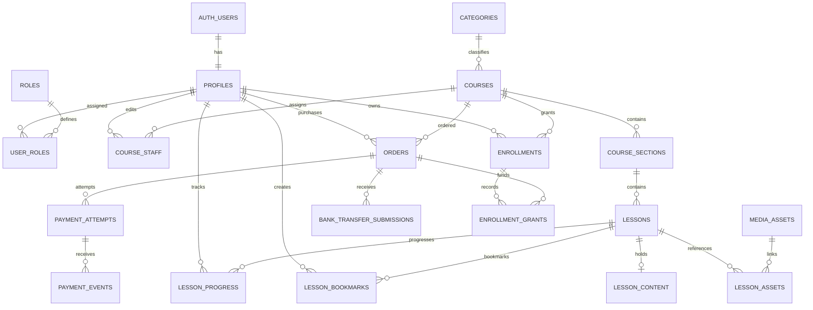

# DATABASE_DESIGN.md
# Acedra - Database Design and Data Security Architecture

Document ID: CSA-DB-001
Version: 1.0
Status: Proposed - Pending Approval
Project: Acedra Course Selling Application
Primary Database: PostgreSQL
Database Platform: Supabase
Authentication: Supabase Auth
Authorization: PostgreSQL Row Level Security
Backend Operations: Supabase Edge Functions
Development Model: Claude + Codex Parallel Engineering
Classification: Internal Engineering Documentation

---

# 1. PURPOSE

This document defines the proposed database
architecture for Acedra.

Acedra is a commercial course-selling
and learning management platform.

The database must support:

- Student identities
- Administrative roles
- Course categories
- Course management
- Curriculum sections
- Lessons
- Protected media references
- Course prices
- Orders
- Online payment attempts
- Verified payment events
- Bank transfer submissions
- Financial reviews
- Course enrollments
- Learning progress
- Bookmarks
- Audit logs
- Notifications
- Reporting

This document establishes the
data design contract for:

CLAUDE:
Flutter frontend development.

CODEX:
Supabase backend development.

Both agents must follow the same
approved schema and API contracts.

---

# 2. RELATED DOCUMENTS

This design must remain consistent with:

- SRS.md
- PLAN.md
- TASKS.md
- AGENTS.md
- ARCHITECTURE.md
- DESIGN_SYSTEM.md
- SECURITY.md
- CONTRIBUTING.md
- TESTING.md
- docs/PARALLEL_WORKFLOW.md
- docs/API_CONTRACTS.md

Document responsibilities:

SRS.md:
Defines expected behavior.

ARCHITECTURE.md:
Defines system and trust boundaries.

DATABASE_DESIGN.md:
Defines persistent data structures.

SECURITY.md:
Defines security requirements.

API_CONTRACTS.md:
Defines frontend/backend interfaces.

TASKS.md:
Tracks schema implementation tasks.

This document is a design specification.

It is not an executed database migration.

---

# 3. DATABASE DESIGN OBJECTIVES

The database must provide:

DB-GOAL-001:
Strong data integrity.

DB-GOAL-002:
Student data isolation.

DB-GOAL-003:
Reliable financial records.

DB-GOAL-004:
Controlled enrollment authorization.

DB-GOAL-005:
Private course content references.

DB-GOAL-006:
Auditable administrative activity.

DB-GOAL-007:
Concurrency-safe operations.

DB-GOAL-008:
Efficient catalog queries.

DB-GOAL-009:
Maintainable schema evolution.

DB-GOAL-010:
Cost-conscious performance.

DB-GOAL-011:
Support for future mobile applications.

DB-GOAL-012:
Safe parallel development.

---

# 4. DATABASE TECHNOLOGY

Database:
PostgreSQL

Managed Service:
Supabase

Authentication:
Supabase Auth

Authorization:
PostgreSQL RLS

File Storage:
Supabase Storage

Privileged Business Logic:
Edge Functions and Database Functions

Local Development:
Supabase CLI

Migration Management:
Version-controlled SQL migrations

Testing:
Supabase database tests and integration tests

Avoid introducing an additional
database during MVP without
an approved architectural reason.

---

# 5. ARCHITECTURAL PRINCIPLES

The following principles are mandatory.

## 5.1 Single Source of Truth

Financial status and entitlement state
must be authoritative in the database.

Flutter UI state is not authoritative.

## 5.2 Referential Integrity

Use foreign keys and constraints
to preserve relationships.

## 5.3 Least Privilege

Grant only the minimum required
table and function permissions.

## 5.4 Deny by Default

Private records must not be accessible
without explicit authorization.

## 5.5 Transactional Integrity

Critical related changes must
commit or fail together.

## 5.6 Idempotency

Repeated requests must not create
invalid duplicate business operations.

## 5.7 Traceability

Financial and administrative changes
must have auditable origins.

## 5.8 Privacy by Design

Keep sensitive information separate
from publicly accessible records.

## 5.9 Migration Safety

Every schema change must be
reviewed, versioned, and tested.

---

# 6. DATABASE SCHEMA ORGANIZATION

Use the following logical schemas.

## 6.1 auth

Managed by Supabase.

Important entity:

auth.users

Responsibilities:

- Authenticated user identity
- Authentication metadata
- Provider-managed credentials
- Identity lifecycle

Do not replace Supabase Auth
with a custom password table.

Do not store plaintext passwords.

## 6.2 public

Application tables permitted for
carefully controlled API exposure.

Examples:

profiles
roles
user_roles
courses
categories
course_sections
lessons
orders
enrollments
lesson_progress

Important:

A table in the public schema
is not necessarily publicly readable.

Use grants and RLS.

## 6.3 app_private

Application-controlled internal schema.

Suggested internal tables:

media_assets
lesson_content
lesson_assets
payment_events
bank_accounts
bank_review_records
audit_logs
notification_outbox
idempotency_records

Certain sensitive tables may also be
kept in public with no client grants.

The final choice must reflect
Supabase API exposure configuration
and function access requirements.

The app_private schema should not
be exposed through normal client APIs.

## 6.4 storage

Managed by Supabase Storage.

Important entities:

storage.buckets
storage.objects

Use supported Storage APIs
for object lifecycle operations.

Do not directly update or delete
Storage metadata as a replacement
for the Storage API.

---

# 7. NAMING CONVENTIONS

Use:

Tables:
snake_case, plural nouns.

Examples:

courses
payment_attempts
bank_transfer_submissions

Columns:
snake_case.

Examples:

course_id
created_at
payment_method

Primary Key:
id

Foreign Keys:
<entity>_id

Timestamps:
created_at
updated_at

Status Fields:
status

Currency:
currency_code

Money:
amount_minor
price_minor

Boolean Fields:
is_published
is_preview
is_completed

Database Functions:
snake_case

Indexes:
idx_<table>_<purpose>

Unique Constraints:
uq_<table>_<purpose>

Foreign Keys:
fk_<table>_<reference>

Use clear names that describe intent.

---

# 8. DATABASE TYPE CONVENTIONS

## 8.1 Identifiers

Use UUID for important records.

Examples:

user_id
course_id
order_id
enrollment_id

Use PostgreSQL-generated UUIDs
where appropriate.

## 8.2 Timestamps

Use:

TIMESTAMPTZ

Store timestamps consistently in UTC.

Convert for display in the frontend
using the user's selected locale/timezone.

## 8.3 Monetary Values

Use:

BIGINT for integer minor units.

Example for LKR:

Rs. 2,500.00

Stored as:

amount_minor = 250000
currency_code = 'LKR'

Do not use FLOAT or DOUBLE PRECISION
as the authoritative money type.

Currency conversion and minor-unit
handling must follow the selected
currency's actual rules.

## 8.4 Status Values

Use lowercase database values.

Examples:

draft
published
paid
active
revoked

The Flutter interface may display
localized or uppercase labels.

## 8.5 JSONB

Use JSONB for appropriate structured data.

Examples:

- Rich text lesson body
- Safe event metadata
- Additional configuration

Do not use JSONB to avoid designing
important relational constraints.

Validate allowed structures and size.

---

# 9. CORE ENTITY OVERVIEW

Identity:

- profiles
- roles
- user_roles
- course_staff

Marketplace:

- categories
- courses
- course_sections
- lessons
- lesson_content
- media_assets
- lesson_assets

Commerce:

- supported_currencies
- orders
- payment_attempts
- payment_events
- bank_accounts
- bank_transfer_submissions
- bank_review_records

Learning:

- enrollments
- enrollment_grants
- lesson_progress
- lesson_bookmarks

Operations:

- audit_logs
- notification_outbox
- idempotency_records

The entities listed here form
the proposed MVP data model.

Not all internal tables should
be accessible directly by Flutter.

---

# 10. ENTITY RELATIONSHIP DIAGRAM



Diagram represents logical relationships.

The final SQL definitions determine
actual cardinality and delete behavior.

---

# 11. IDENTITY: PROFILES

Table:

public.profiles

Purpose:

Store application-specific
student profile information.

Do not duplicate passwords or
sensitive Supabase Auth credentials.

## Columns

id:
UUID, PRIMARY KEY

References:
auth.users.id

display_name:
TEXT, NOT NULL

avatar_path:
TEXT, NULLABLE

locale:
TEXT, NULLABLE

created_at:
TIMESTAMPTZ, NOT NULL

updated_at:
TIMESTAMPTZ, NOT NULL

## Constraints

- id must reference a valid Auth user.
- display_name must respect length limits.
- avatar_path must follow storage policy.
- timestamps must be valid.

## Access Rules

Student:

- Read own profile.
- Update permitted profile fields.
- Cannot change profile identity.
- Cannot modify admin permissions.

Administrators:

Access only information necessary
for authorized administrative operations.

## Security

A student must never be able
to update another student's profile.

Do not include administrative roles
as client-editable profile fields.

## Account Deletion

Do not rely on automatic CASCADE
deletion of financial history.

Auth account deletion and profile
deletion require a coordinated policy
that respects privacy and legal retention.

Foreign-key delete behavior must
be finalized before migrations.

---

# 12. AUTHORIZATION: ROLES

Table:

public.roles

Purpose:

Define supported application roles.

## Columns

id:
UUID, PRIMARY KEY

code:
TEXT, UNIQUE, NOT NULL

name:
TEXT, NOT NULL

description:
TEXT, NULLABLE

created_at:
TIMESTAMPTZ, NOT NULL

## Initial Role Codes

student

content_manager

finance_admin

super_admin

Guest is an unauthenticated access state,
not necessarily a stored user role.

Authenticated users are ordinary students
unless explicitly granted elevated roles.

## Rules

- Roles are seeded by trusted migrations.
- Students cannot create roles.
- Students cannot assign roles.
- Role definitions are controlled.
- Privileged changes are audited.

Avoid treating a role displayed
in the Flutter UI as proof of permission.

---

# 13. AUTHORIZATION: USER ROLES

Table:

public.user_roles

Purpose:

Track explicit privileged
role assignments.

## Columns

id:
UUID, PRIMARY KEY

user_id:
UUID, NOT NULL

role_id:
UUID, NOT NULL

granted_by:
UUID, NULLABLE

granted_at:
TIMESTAMPTZ, NOT NULL

revoked_at:
TIMESTAMPTZ, NULLABLE

revoked_by:
UUID, NULLABLE

## Constraints

- Valid user required.
- Valid role required.
- Prevent duplicate active
  role assignments for one user.
- Preserve historical revocation records.

## Security

Only trusted administrative operations
may insert, revoke, or change roles.

No direct student writes.

## Important

Never use editable user metadata
as authoritative admin permission.

Sensitive actions should check
current trusted permission records.

---

# 14. COURSE STAFF ASSIGNMENTS

Table:

public.course_staff

Purpose:

Assign content management permissions
to specific courses.

## Columns

id:
UUID, PRIMARY KEY

course_id:
UUID, NOT NULL

user_id:
UUID, NOT NULL

staff_role:
TEXT, NOT NULL

assigned_by:
UUID, NULLABLE

assigned_at:
TIMESTAMPTZ, NOT NULL

revoked_at:
TIMESTAMPTZ, NULLABLE

## Suggested Staff Roles

owner
editor

## Rules

- Assignment requires an authorized role.
- Course scope must be validated.
- Revoked assignments do not authorize edits.
- Changes must be audited.

Content managers should not
automatically access all financial data.

---

# 15. COURSE CATEGORIES

Table:

public.categories

Purpose:

Organize courses for discovery.

## Columns

id:
UUID, PRIMARY KEY

name:
TEXT, NOT NULL

slug:
TEXT, UNIQUE, NOT NULL

description:
TEXT, NULLABLE

sort_order:
INTEGER, NOT NULL

is_active:
BOOLEAN, NOT NULL

created_at:
TIMESTAMPTZ, NOT NULL

updated_at:
TIMESTAMPTZ, NOT NULL

## Rules

- Only active categories are publicly listed.
- Names and slugs must be validated.
- Category deletion must not
  accidentally delete courses.

## Access

Guest/Student:
Read active categories.

Content Management:
Trusted administrative operations.

---

# 16. COURSES

Table:

public.courses

Purpose:

Store course marketplace metadata
and current pricing.

## Columns

id:
UUID, PRIMARY KEY

category_id:
UUID, NULLABLE

slug:
TEXT, UNIQUE, NOT NULL

title:
TEXT, NOT NULL

short_description:
TEXT, NULLABLE

description:
TEXT, NULLABLE

thumbnail_path:
TEXT, NULLABLE

price_minor:
BIGINT, NOT NULL

currency_code:
TEXT, NOT NULL

status:
TEXT, NOT NULL

created_by:
UUID, NULLABLE

published_at:
TIMESTAMPTZ, NULLABLE

created_at:
TIMESTAMPTZ, NOT NULL

updated_at:
TIMESTAMPTZ, NOT NULL

## Course Statuses

draft
published
archived

## Constraints

- Slug must be unique.
- Title cannot be empty.
- Price cannot be negative.
- Currency must be supported.
- Published courses require
  valid publication metadata.

## Important Pricing Rule

Course price is authoritative
only when read from trusted backend data.

During checkout:

- Read current server-side course price.
- Validate course availability.
- Copy price and currency into order.
- Do not trust client-provided price.

After order creation:

Changing course price must not
modify historical order amounts.

## Access

Guest:
Read published courses.

Student:
Read published courses.

Content Manager:
Manage authorized course content.

Finance Admin:
Read necessary commerce information.

Super Admin:
Perform explicitly authorized
course management operations.

Course creation, editing, pricing,
and publishing should use
trusted management workflows.

---

# 17. COURSE SECTIONS

Table:

public.course_sections

Purpose:

Organize curriculum within a course.

## Columns

id:
UUID, PRIMARY KEY

course_id:
UUID, NOT NULL

title:
TEXT, NOT NULL

description:
TEXT, NULLABLE

position:
INTEGER, NOT NULL

is_published:
BOOLEAN, NOT NULL

created_at:
TIMESTAMPTZ, NOT NULL

updated_at:
TIMESTAMPTZ, NOT NULL

## Constraints

- Valid parent course.
- Position must be nonnegative.
- Position unique within course
  under the approved ordering policy.

## Public Access

A section can be publicly listed only when:

- Parent course is published.
- Section is published.

Content access is separate
from curriculum metadata.

---

# 18. LESSONS

Table:

public.lessons

Purpose:

Store lesson metadata
without exposing paid content.

## Columns

id:
UUID, PRIMARY KEY

section_id:
UUID, NOT NULL

title:
TEXT, NOT NULL

description:
TEXT, NULLABLE

lesson_type:
TEXT, NOT NULL

position:
INTEGER, NOT NULL

duration_seconds:
INTEGER, NULLABLE

is_preview:
BOOLEAN, NOT NULL

is_published:
BOOLEAN, NOT NULL

created_at:
TIMESTAMPTZ, NOT NULL

updated_at:
TIMESTAMPTZ, NOT NULL

## Lesson Types

video
pdf
text
image

## Constraints

- Section must exist.
- Type must be supported.
- Duration cannot be negative.
- Ordering must be valid.
- Published status must be explicit.

## Critical Security Rule

Do not put private storage paths,
full paid lesson text, signed URLs,
or video playback secrets in
publicly readable lesson metadata.

A visitor may view lesson titles
without gaining access to lesson content.

---

# 19. PROTECTED LESSON CONTENT

Table:

app_private.lesson_content

Purpose:

Store content data that should
not be directly publicly queried.

## Columns

lesson_id:
UUID, PRIMARY KEY

body_json:
JSONB, NULLABLE

content_version:
INTEGER, NOT NULL

created_at:
TIMESTAMPTZ, NOT NULL

updated_at:
TIMESTAMPTZ, NOT NULL

## Usage

Text lessons:

Validated structured lesson content.

PDF/video/image lessons:

Protected asset references are managed
through media association tables.

## Rules

- No anonymous direct access.
- No unrestricted student direct access.
- Validate active entitlement.
- Validate content publication state.
- Restrict editing to authorized managers.
- Sanitize or safely render rich text.
- Restrict content size.

## Preview Content

Public lesson previews must use
an explicitly approved preview pathway.

Do not accidentally expose paid
content through preview metadata.

---

# 20. MEDIA ASSETS

Table:

app_private.media_assets

Purpose:

Maintain protected references
to stored course assets.

## Columns

id:
UUID, PRIMARY KEY

asset_type:
TEXT, NOT NULL

storage_provider:
TEXT, NOT NULL

bucket_name:
TEXT, NULLABLE

object_path:
TEXT, NULLABLE

external_asset_id:
TEXT, NULLABLE

mime_type:
TEXT, NULLABLE

size_bytes:
BIGINT, NULLABLE

checksum_sha256:
TEXT, NULLABLE

uploaded_by:
UUID, NULLABLE

created_at:
TIMESTAMPTZ, NOT NULL

deleted_at:
TIMESTAMPTZ, NULLABLE

## Asset Types

course_pdf
lesson_image
course_video
bank_receipt
public_thumbnail
other

## Storage Rules

- Private content must use private storage.
- Do not use predictable private URLs.
- Do not expose protected object paths
  in public course records.
- Validate uploaded file types.
- Validate file ownership.
- Apply file size limits.
- Restrict asset listing.

Do not store large binary
documents inside PostgreSQL.

---

# 21. LESSON ASSET ASSOCIATIONS

Table:

app_private.lesson_assets

Purpose:

Connect lessons to protected media assets.

## Columns

id:
UUID, PRIMARY KEY

lesson_id:
UUID, NOT NULL

media_asset_id:
UUID, NOT NULL

usage:
TEXT, NOT NULL

position:
INTEGER, NOT NULL

created_at:
TIMESTAMPTZ, NOT NULL

## Examples

Lesson:
Introduction to Programming

Assets:

- Main video
- Supporting PDF
- Lesson illustration

## Security

The backend must validate that
the student may access the lesson
before authorizing asset delivery.

Possession of a media asset UUID
must not grant file access.

---

# 22. SUPPORTED CURRENCIES

Table:

public.supported_currencies

Purpose:

Define approved currencies
and their minor-unit behavior.

## Columns

code:
TEXT, PRIMARY KEY

name:
TEXT, NOT NULL

minor_unit:
SMALLINT, NOT NULL

is_enabled:
BOOLEAN, NOT NULL

created_at:
TIMESTAMPTZ, NOT NULL

## Example

code:
LKR

minor_unit:
2

## Rules

- Currency codes must use
  approved ISO-style identifiers.
- Currency configuration is trusted.
- Disabled currencies cannot
  be used for new checkouts.
- Historical orders preserve currency.
- Conversion rules require separate
  approved business logic.

---

# 23. ORDERS

Table:

public.orders

Purpose:

Represent student purchase requests.

MVP:

One course per order.

## Columns

id:
UUID, PRIMARY KEY

order_number:
TEXT, UNIQUE, NOT NULL

buyer_id:
UUID, NOT NULL

course_id:
UUID, NOT NULL

course_title_snapshot:
TEXT, NOT NULL

amount_minor:
BIGINT, NOT NULL

currency_code:
TEXT, NOT NULL

payment_method:
TEXT, NOT NULL

status:
TEXT, NOT NULL

access_duration_snapshot_days:
INTEGER, NULLABLE

created_at:
TIMESTAMPTZ, NOT NULL

updated_at:
TIMESTAMPTZ, NOT NULL

paid_at:
TIMESTAMPTZ, NULLABLE

cancelled_at:
TIMESTAMPTZ, NULLABLE

## Payment Methods

online

bank_transfer

## Order States

created
pending_payment
pending_verification
paid
failed
cancelled
refunded

## Constraints

- Buyer must be valid.
- Course must be valid.
- Amount must be nonnegative.
- Currency must be supported.
- Payment method must be valid.
- State must be valid.
- Snapshot fields must remain immutable.

## Critical Rules

The client must not directly:

- Insert authoritative orders
- Update payment status
- Change order amount
- Change order currency
- Set paid_at
- Modify purchase ownership

Create orders through trusted backend logic.

## Price Snapshot

Store the price at purchase initiation.

Example:

Course current price:
LKR 3,000.00

Order snapshot:
amount_minor = 300000

Later course price:
LKR 3,500.00

Historical order remains:
amount_minor = 300000

Never recalculate old order totals
from the current course price.

---

# 24. PAYMENT ATTEMPTS

Table:

public.payment_attempts

Direct Client Access:
Restricted

Purpose:

Track attempts to pay an order.

## Columns

id:
UUID, PRIMARY KEY

order_id:
UUID, NOT NULL

method:
TEXT, NOT NULL

provider:
TEXT, NULLABLE

provider_session_id:
TEXT, NULLABLE

provider_transaction_id:
TEXT, NULLABLE

amount_minor:
BIGINT, NOT NULL

currency_code:
TEXT, NOT NULL

status:
TEXT, NOT NULL

created_at:
TIMESTAMPTZ, NOT NULL

updated_at:
TIMESTAMPTZ, NOT NULL

completed_at:
TIMESTAMPTZ, NULLABLE

## Suggested States

initialized
pending
succeeded
failed
cancelled
refunded

## Constraints

- Attempt must belong to an order.
- Amount must match approved order terms.
- Provider transaction references
  must have appropriate uniqueness.
- State transitions must be validated.

## Important

A payment attempt can fail
without deleting the original order.

Never trust a frontend field
to mark an attempt successful.

---

# 25. VERIFIED PAYMENT EVENTS

Table:

app_private.payment_events

Purpose:

Store verified payment provider events
for idempotency and auditability.

## Columns

id:
UUID, PRIMARY KEY

payment_attempt_id:
UUID, NOT NULL

provider:
TEXT, NOT NULL

provider_event_id:
TEXT, NOT NULL

event_type:
TEXT, NOT NULL

payload_hash:
TEXT, NULLABLE

received_at:
TIMESTAMPTZ, NOT NULL

processed_at:
TIMESTAMPTZ, NULLABLE

processing_status:
TEXT, NOT NULL

safe_metadata:
JSONB, NULLABLE

## Constraints

Unique:

(provider, provider_event_id)

## Critical Event Rules

Only authenticated and validated
provider events should enter this
verified event processing ledger.

Do not reserve a verified event ID
based on an unauthenticated request.

Otherwise, forged requests could block
a legitimate event with the same ID.

Rejected or suspicious requests may be
recorded separately in security logs.

Do not store unnecessary raw card data,
provider credentials, or secrets.

---

# 26. BANK ACCOUNTS

Table:

app_private.bank_accounts

Purpose:

Store official bank accounts
approved for receiving course payments.

## Columns

id:
UUID, PRIMARY KEY

bank_name:
TEXT, NOT NULL

account_name:
TEXT, NOT NULL

account_number:
TEXT, NOT NULL

branch_name:
TEXT, NULLABLE

currency_code:
TEXT, NOT NULL

is_active:
BOOLEAN, NOT NULL

version:
INTEGER, NOT NULL

created_at:
TIMESTAMPTZ, NOT NULL

archived_at:
TIMESTAMPTZ, NULLABLE

## Security

- Only trusted administrators can modify.
- Changes must be audited.
- Account details must not be
  controlled by student input.
- Historical payment records must
  preserve the intended destination.
- Retired accounts should not be
  used for new payment instructions.

Bank details returned to students
must come from trusted configuration.

---

# 27. BANK TRANSFER SUBMISSIONS

Table:

public.bank_transfer_submissions

Purpose:

Track uploaded payment evidence
and its review state.

## Columns

id:
UUID, PRIMARY KEY

order_id:
UUID, NOT NULL

submitted_by:
UUID, NOT NULL

receipt_asset_id:
UUID, NULLABLE

status:
TEXT, NOT NULL

submitted_at:
TIMESTAMPTZ, NULLABLE

reviewed_by:
UUID, NULLABLE

reviewed_at:
TIMESTAMPTZ, NULLABLE

public_rejection_reason:
TEXT, NULLABLE

created_at:
TIMESTAMPTZ, NOT NULL

updated_at:
TIMESTAMPTZ, NOT NULL

## Statuses

awaiting_receipt
submitted
under_review
approved
rejected

## Rules

- Submission must belong to an order.
- Order must use bank_transfer method.
- Student identity must match order buyer.
- Receipt must exist before submission.
- Receipt must pass validation.
- Review requires authorized finance role.
- Approval requires independent
  bank settlement verification.

## Resubmission

Do not overwrite a rejected
submission's original receipt
and review history.

A permitted resubmission should
create a new submission record.

A partial unique constraint should
prevent conflicting simultaneously
active submissions per order.

## Critical

Submitting a receipt must not
create an active enrollment.

Only verified approval may
activate course access.

---

# 28. BANK REVIEW RECORDS

Table:

app_private.bank_review_records

Purpose:

Store sensitive internal
payment verification information.

## Columns

id:
UUID, PRIMARY KEY

submission_id:
UUID, NOT NULL

reviewer_id:
UUID, NOT NULL

decision:
TEXT, NOT NULL

bank_account_id:
UUID, NULLABLE

verified_transaction_id:
TEXT, NULLABLE

verified_amount_minor:
BIGINT, NULLABLE

verified_currency:
TEXT, NULLABLE

verification_notes:
TEXT, NULLABLE

created_at:
TIMESTAMPTZ, NOT NULL

## Rules

- Restrict to authorized financial operations.
- Preserve review history.
- Separate internal notes from
  student-visible rejection messages.
- Verify amount, currency, and destination.
- Prevent reuse of confirmed settlement IDs
  when the bank provides reliable IDs.

## Fraud Prevention

Flag potentially reused:

- Bank settlement references
- Receipt files
- Transaction identifiers
- Financial evidence

Do not assume an arbitrary
user-entered bank reference
is globally unique.

The verified bank transaction identifier
should come from independently
confirmed settlement evidence.

## Separation of Duties

Recommended:

A finance reviewer should not approve
their own course purchase.

Apply additional review for exceptional
manual financial adjustments.

---

# 29. ENROLLMENTS

Table:

public.enrollments

Purpose:

Represent current course access rights.

## Columns

id:
UUID, PRIMARY KEY

user_id:
UUID, NOT NULL

course_id:
UUID, NOT NULL

status:
TEXT, NOT NULL

granted_at:
TIMESTAMPTZ, NOT NULL

expires_at:
TIMESTAMPTZ, NULLABLE

revoked_at:
TIMESTAMPTZ, NULLABLE

revocation_reason:
TEXT, NULLABLE

created_at:
TIMESTAMPTZ, NOT NULL

updated_at:
TIMESTAMPTZ, NOT NULL

## Statuses

active
expired
revoked

## Uniqueness

Unique:

(user_id, course_id)

MVP maintains one current
entitlement record per user/course.

## Access Rule

Access is permitted only when:

- User is authenticated.
- Enrollment belongs to that user.
- Enrollment matches the course.
- Status is active.
- Expiry has not passed.
- No applicable access restriction exists.

Important:

Even if a background expiry job
has not updated status to expired,
a past expires_at must deny new access.

## Trusted Mutations

Only trusted backend operations may:

- Activate enrollment
- Reactivate enrollment
- Revoke enrollment
- Change expiration
- Perform administrative grants

Students may read their own enrollments.

Students must not modify them.

---

# 30. ENROLLMENT GRANTS

Table:

public.enrollment_grants

Direct Client Access:
Restricted

Purpose:

Record why a course entitlement
was granted or reactivated.

## Columns

id:
UUID, PRIMARY KEY

enrollment_id:
UUID, NOT NULL

source_type:
TEXT, NOT NULL

source_order_id:
UUID, NULLABLE

granted_by:
UUID, NULLABLE

reason:
TEXT, NULLABLE

created_at:
TIMESTAMPTZ, NOT NULL

## Grant Sources

online_payment
bank_transfer
admin_grant

## Rules

- Every grant must have a valid source.
- Payment-funded grants require
  verified financial state.
- Admin grants require authorization.
- Duplicate order-funded grants
  must be prevented.
- Historical grants must be preserved.

## Recommended Constraint

Unique:

source_order_id where not null.

This prevents one paid order
from producing multiple grant records.

## Re-purchase After Revocation

If a revoked student purchases again:

- Verify the new payment.
- Revalidate entitlement policy.
- Update the current enrollment safely.
- Record a new grant with the new source.

Do not erase previous financial history.

---

# 31. LEARNING PROGRESS

Table:

public.lesson_progress

Purpose:

Track a student's progress in lessons.

## Columns

id:
UUID, PRIMARY KEY

user_id:
UUID, NOT NULL

lesson_id:
UUID, NOT NULL

progress_seconds:
INTEGER, NULLABLE

pdf_page:
INTEGER, NULLABLE

is_completed:
BOOLEAN, NOT NULL

last_opened_at:
TIMESTAMPTZ, NULLABLE

created_at:
TIMESTAMPTZ, NOT NULL

updated_at:
TIMESTAMPTZ, NOT NULL

## Uniqueness

Unique:

(user_id, lesson_id)

## Constraints

- Progress cannot be negative.
- PDF page must be positive.
- Lesson must exist.
- User must exist.

## Ownership

Students may manage only
their own learning progress.

A progress write must not
establish an entitlement.

Where access validation is required,
verify the student is authorized
to access the corresponding lesson.

## Completion

The MVP may permit students
to mark permitted lessons completed.

Do not use student-controlled completion
as trusted evidence for graded assessments
or certificates without additional rules.

---

# 32. LESSON BOOKMARKS

Table:

public.lesson_bookmarks

Purpose:

Allow students to save
positions in learning materials.

## Columns

id:
UUID, PRIMARY KEY

user_id:
UUID, NOT NULL

lesson_id:
UUID, NOT NULL

label:
TEXT, NULLABLE

pdf_page:
INTEGER, NULLABLE

position_seconds:
INTEGER, NULLABLE

created_at:
TIMESTAMPTZ, NOT NULL

## Rules

- User must own bookmark.
- Lesson must be valid.
- Bookmark data must be validated.
- Bookmark queries must respect
  student data isolation.

Advanced bookmarking may be
implemented after core MVP
according to TASKS.md.

---

# 33. AUDIT LOGS

Table:

app_private.audit_logs

Purpose:

Record important security,
financial, and administrative events.

## Columns

id:
UUID, PRIMARY KEY

actor_user_id:
UUID, NULLABLE

action:
TEXT, NOT NULL

resource_type:
TEXT, NOT NULL

resource_id:
UUID, NULLABLE

request_id:
TEXT, NULLABLE

outcome:
TEXT, NOT NULL

safe_metadata:
JSONB, NULLABLE

created_at:
TIMESTAMPTZ, NOT NULL

## Example Actions

payment_verified

bank_transfer_approved

bank_transfer_rejected

enrollment_granted

enrollment_revoked

course_published

course_unpublished

admin_role_assigned

admin_role_revoked

## Security

- Append-only application behavior.
- No student modification.
- Restricted read access.
- Sensitive field redaction.
- Appropriate retention policy.
- Audit event included in critical
  financial database transactions.

Never record:

- Plaintext passwords
- Access tokens
- Payment gateway secrets
- Full bank receipts
- Complete signed PDF URLs

## Integrity

Ordinary application users
must not update or delete audit records.

Administrative retention and
legal deletion procedures require
separately authorized operations.

---

# 34. NOTIFICATION OUTBOX

Table:

app_private.notification_outbox

Purpose:

Reliably process transactional notifications.

## Columns

id:
UUID, PRIMARY KEY

event_key:
TEXT, UNIQUE, NOT NULL

recipient_user_id:
UUID, NULLABLE

notification_type:
TEXT, NOT NULL

safe_payload:
JSONB, NULLABLE

status:
TEXT, NOT NULL

attempt_count:
INTEGER, NOT NULL

next_attempt_at:
TIMESTAMPTZ, NULLABLE

created_at:
TIMESTAMPTZ, NOT NULL

sent_at:
TIMESTAMPTZ, NULLABLE

## Notification Types

payment_verified

bank_receipt_submitted

bank_transfer_approved

bank_transfer_rejected

enrollment_revoked

## Rules

- Financial transaction must not
  depend on successful email delivery.
- Notification retries must be safe.
- Duplicate notification events
  should be prevented.
- Private information must be minimized.

Workers should process outbox records
using a safe claim/lease mechanism
when concurrent workers are possible.

---

# 35. IDEMPOTENCY RECORDS

Table:

app_private.idempotency_records

Purpose:

Prevent unintended duplicate
business operations.

## Columns

id:
UUID, PRIMARY KEY

actor_user_id:
UUID, NULLABLE

operation:
TEXT, NOT NULL

idempotency_key:
TEXT, NOT NULL

request_hash:
TEXT, NOT NULL

resource_id:
UUID, NULLABLE

created_at:
TIMESTAMPTZ, NOT NULL

expires_at:
TIMESTAMPTZ, NULLABLE

## Unique Constraint

(actor_user_id, operation, idempotency_key)

For service-generated operations,
define a separate stable scope
rather than relying on nullable
actor uniqueness.

## Examples

- Checkout creation
- Manual payment review
- Administrative enrollment grant

## Rules

- Validate actor identity.
- Validate request body consistency.
- Return safe existing results for retries.
- Do not allow one key to authorize
  different request bodies.
- Ensure concurrent requests
  cannot create duplicate effects.

Payment provider events additionally
require their own unique verified
provider event identifiers.

---

# 36. DATABASE RELATIONSHIP RULES

Important relationships:

profiles.id
  -> auth.users.id

courses.category_id
  -> categories.id

course_sections.course_id
  -> courses.id

lessons.section_id
  -> course_sections.id

orders.buyer_id
  -> profiles.id

orders.course_id
  -> courses.id

payment_attempts.order_id
  -> orders.id

bank_transfer_submissions.order_id
  -> orders.id

enrollments.user_id
  -> profiles.id

enrollments.course_id
  -> courses.id

lesson_progress.user_id
  -> profiles.id

lesson_progress.lesson_id
  -> lessons.id

## Deletion Policy

Do not cascade-delete:

- Paid orders
- Verified payment history
- Financial audit records
- Bank review history
- Enrollment grant history

Course archival is preferred
over destructive deletion
when purchases already exist.

Student account deletion requires
a dedicated privacy/retention workflow.

The final delete strategy must
be approved before production.

---

# 37. FINANCIAL STATE MACHINES

Payment and enrollment states
must use defined transitions.

## 37.1 Order State Machine

created
  |
  v
pending_payment
  |
  +----> pending_verification
  |               |
  |               +----> paid
  |               |
  |               +----> pending_payment
  |                      if receipt rejected
  |                      and resubmission allowed
  |
  +----> paid
  |
  +----> failed
  |
  +----> cancelled

paid
  |
  v
refunded
  only through approved workflow

Actual transitions depend on
the selected payment provider
and approved business policies.

## 37.2 Bank Submission State Machine

awaiting_receipt
  |
  v
submitted
  |
  v
under_review
  |
  +----> approved
  |
  +----> rejected

Rejected records remain historical.

A new permitted submission may
be created for resubmission.

## 37.3 Enrollment State Machine

active
  |
  +----> expired
  |
  +----> revoked

A new verified grant may reactivate
an entitlement under approved policy.

## 37.4 Critical Rule

Never allow an older failed callback
to downgrade an already verified paid order.

State transitions must be validated
inside trusted transactional logic.

---

# 38. ONLINE PAYMENT TRANSACTION FLOW

The approved online payment process:

1. Student requests checkout.
2. Backend authenticates student.
3. Backend validates published course.
4. Backend checks existing enrollment.
5. Backend reads current price.
6. Backend creates order snapshot.
7. Backend creates payment attempt.
8. Payment provider creates checkout.
9. Student completes provider checkout.
10. Provider sends verified notification.
11. Backend authenticates notification.
12. Backend identifies payment attempt.
13. Backend validates amount and currency.
14. Database transaction locks records.
15. Duplicate event is checked.
16. Payment event is recorded.
17. Payment attempt is finalized.
18. Order becomes paid.
19. Enrollment is granted.
20. Enrollment grant source is recorded.
21. Audit event is recorded.
22. Notification event is queued.
23. Transaction commits.
24. Frontend refreshes server state.

## Atomic Requirement

Steps involving database state
finalization must commit together.

A failure must not leave:

- Paid order without intended entitlement
- Entitlement without verified payment
- Duplicate order-funded grants
- Inconsistent financial history

External provider calls must not
be treated as part of a PostgreSQL
transaction.

Use reconciliation when an external
system succeeded but internal processing
was interrupted.

---

# 39. BANK TRANSFER TRANSACTION FLOW

1. Student selects bank transfer.
2. Backend creates order.
3. Backend returns official bank details.
4. Student transfers money.
5. Student uploads private receipt.
6. Backend validates submission.
7. Order enters pending verification.
8. Finance administrator opens review.
9. Reviewer independently confirms
   actual bank settlement.
10. Authorized review request is submitted.
11. Backend verifies reviewer permissions.
12. Database transaction locks records.
13. Submission state is checked.
14. Verified settlement is recorded.
15. Order becomes paid if approved.
16. Entitlement is granted if approved.
17. Audit event is created.
18. Notification is queued.
19. Transaction commits.

If rejected:

- Record rejection.
- Preserve evidence.
- Preserve review history.
- Do not create enrollment.
- Allow resubmission only if policy permits.

## Critical Requirements

The database must prevent
multiple conflicting final reviews.

The reviewer must not be able
to approve an already finalized record
through an unsafe repeated request.

---

# 40. ROW LEVEL SECURITY STRATEGY

RLS is mandatory for protected
tables exposed through the Supabase API.

RLS must be combined with
appropriate database grants.

Never assume RLS alone controls
every possible column mutation.

## General Rules

- Enable RLS.
- Revoke unnecessary privileges.
- Grant required operations only.
- Write explicit policies.
- Test anonymous requests.
- Test authenticated student requests.
- Test cross-student access.
- Test unauthorized administrative actions.
- Test direct API requests.

No RLS policy should grant
unrestricted access merely
because a user is authenticated.

---

# 41. ACCESS CONTROL MATRIX

The following describes the
intended effective access model.

TRUSTED means approved server-side
operation with explicit authorization.

| Table | Guest | Student | Content Manager | Finance Admin | Super Admin |
|---|---|---|---|---|---|
| profiles | None | Own | Limited trusted | Limited trusted | Trusted |
| roles | None | None | None | None | Trusted |
| user_roles | None | None | None | None | Trusted |
| course_staff | None | None | Scoped trusted | None | Trusted |
| categories | Public read | Public read | Trusted manage | Public read | Trusted |
| courses | Published read | Published read | Scoped trusted manage | Published read | Trusted |
| course_sections | Published read | Published read | Scoped trusted manage | Published read | Trusted |
| lessons | Published metadata | Published metadata | Scoped trusted manage | Published metadata | Trusted |
| lesson_content | Preview only via approved API | Entitled via API | Scoped trusted | None | Trusted |
| media_assets | None | Authorized delivery API | Scoped trusted | Receipt review only | Trusted |
| orders | None | Own read | None | Restricted trusted | Trusted |
| payment_attempts | None | Status via approved API | None | Trusted | Trusted |
| payment_events | None | None | None | Restricted trusted | Trusted |
| bank_transfer_submissions | None | Own read | None | Trusted review | Trusted |
| bank_review_records | None | None | None | Trusted review | Trusted |
| enrollments | None | Own read | None | Restricted trusted | Trusted |
| enrollment_grants | None | Own summary via API | None | Restricted trusted | Trusted |
| lesson_progress | None | Own read/write | None | None | Trusted |
| lesson_bookmarks | None | Own read/write | None | None | Trusted |
| audit_logs | None | None | None | Scoped trusted | Trusted |
| notification_outbox | None | None | None | None | Trusted worker |

Important:

Application roles are not the same
as PostgreSQL API roles.

An authenticated administrator still
uses the normal authenticated client role
unless a trusted backend operation
performs explicitly elevated work.

Administrative authorization must
be checked independently by the backend.

---

# 42. EXAMPLE SQL: COURSES AND PUBLIC CATALOG

The following is an illustrative
migration fragment.

It is not the entire course schema.

```sql
create table public.courses (
  id uuid primary key default gen_random_uuid(),

  category_id uuid
    references public.categories(id),

  slug text not null unique,

  title text not null,

  short_description text,

  description text,

  thumbnail_path text,

  price_minor bigint not null
    check (price_minor >= 0),

  currency_code text not null
    check (
      currency_code ~ '^[A-Z]{3}$'
    ),

  status text not null default 'draft'
    check (
      status in (
        'draft',
        'published',
        'archived'
      )
    ),

  created_by uuid
    references public.profiles(id),

  published_at timestamptz,

  created_at timestamptz not null
    default now(),

  updated_at timestamptz not null
    default now(),

  constraint published_requires_date
    check (
      status <> 'published'
      or published_at is not null
    )
);
```

Requirements:

- Create referenced tables first.
- Add approved currency validation.
- Add meaningful length constraints.
- Add indexes where required.
- Add update timestamp handling.
- Finalize deletion rules.
- Apply permissions in the migration.

## RLS Example

```sql
alter table public.courses
enable row level security;

revoke all on table public.courses
from anon, authenticated;

grant select on table public.courses
to anon, authenticated;

create policy courses_public_read
on public.courses
for select
to anon, authenticated
using (
  status = 'published'
  and published_at is not null
);
```

This example allows reading
only published course rows.

It does not authorize:

- Course creation
- Course price changes
- Publishing
- Course deletion

Those require trusted operations.

Do not place sensitive content
in publicly readable course columns.

---

# 43. EXAMPLE SQL: OWN ORDERS

Students may read their own orders.

They must not directly create paid
orders or update financial status.

```sql
alter table public.orders
enable row level security;

revoke all on table public.orders
from anon, authenticated;

grant select on table public.orders
to authenticated;

create policy orders_read_own
on public.orders
for select
to authenticated
using (
  buyer_id = (select auth.uid())
);
```

No direct client INSERT,
UPDATE, or DELETE grant
is provided in this example.

Trusted checkout functions create orders.

Trusted payment finalization functions
update order status.

## Important

Ensure the actual order schema
does not expose internal-only
payment secrets through SELECT.

Place sensitive operational metadata
in restricted internal tables.

---

# 44. EXAMPLE SQL: OWN ENROLLMENTS

Students may inspect their
own current course entitlements.

```sql
alter table public.enrollments
enable row level security;

revoke all on table public.enrollments
from anon, authenticated;

grant select on table public.enrollments
to authenticated;

create policy enrollments_read_own
on public.enrollments
for select
to authenticated
using (
  user_id = (select auth.uid())
);
```

No student write grant is provided.

The frontend cannot directly:

- Activate access
- Extend expiration
- Revoke another enrollment
- Change course ownership

All mutations require trusted workflows.

---

# 45. EXAMPLE SQL: PROFILE COLUMN PROTECTION

RLS restricts rows.

It does not automatically restrict
which columns in an authorized row
may be modified.

If direct profile edits are permitted,
use narrow column grants.

Illustrative example:

```sql
alter table public.profiles
enable row level security;

revoke all on table public.profiles
from anon, authenticated;

grant select on table public.profiles
to authenticated;

grant update (
  display_name,
  avatar_path,
  locale
)
on public.profiles
to authenticated;

create policy profiles_read_own
on public.profiles
for select
to authenticated
using (
  id = (select auth.uid())
);

create policy profiles_update_own
on public.profiles
for update
to authenticated
using (
  id = (select auth.uid())
)
with check (
  id = (select auth.uid())
);
```

Important:

The table must not also have
a broader UPDATE grant that defeats
the intended column restrictions.

A trusted profile update API
is an acceptable alternative.

---

# 46. PRIVILEGED FUNCTION DESIGN

Privileged database operations
must not be exposed casually.

Suggested trusted functions:

finalize_verified_payment

approve_bank_transfer

reject_bank_transfer

grant_course_enrollment

revoke_course_enrollment

assign_admin_role

publish_course

archive_course

## Function Rules

- Prefer SECURITY INVOKER.
- Use SECURITY DEFINER only
  when elevated access is necessary.
- Restrict EXECUTE privileges.
- Set a safe search_path.
- Validate inputs.
- Verify relevant actor permissions.
- Lock records for concurrent updates.
- Use atomic database transactions.
- Create appropriate audit records.
- Never expose unrestricted mutations
  through anonymous RPCs.

## Function Grants

An illustrative restricted function
privilege pattern:

```sql
revoke execute on function
  public.finalize_verified_payment(
    uuid,
    text
  )
from public, anon, authenticated;

grant execute on function
  public.finalize_verified_payment(
    uuid,
    text
  )
to service_role;
```

This assumes the function already exists
with exactly that signature.

The final function signature and
execution identity require review.

## Critical Security Point

Granting EXECUTE to authenticated
does not automatically make a
SECURITY DEFINER function safe.

A privileged function must still
enforce object-level authorization.

Avoid exposing privileged SQL functions
through normal student-accessible APIs.

---

# 47. AUTHORIZED CONTENT ACCESS

Protected content access must be
based on active entitlements.

## Required Conditions

Student is authenticated.

Student has an enrollment for
the requested course.

Enrollment is active.

Enrollment has not expired.

Lesson belongs to the course.

Lesson and course are available
under the approved publication rules.

## Proposed Backend Operation

authorize_course_content

Input:

lesson_id

Trusted Backend Steps:

1. Verify user identity.
2. Resolve lesson and parent course.
3. Check active entitlement.
4. Check access restrictions.
5. Resolve protected media asset.
6. Generate approved limited access.
7. Return controlled response.

Do not return unrestricted
private object metadata.

## Preview Exception

A preview lesson must be explicitly
approved for public delivery.

Do not automatically expose
paid lesson assets just because
their titles are publicly listed.

---

# 48. PRIVATE STORAGE DESIGN

Recommended buckets:

course-thumbnails
course-pdfs
lesson-images
bank-receipts

Potential external provider:

protected-videos

## Bucket Policies

course-thumbnails:
Public after approved publication.

course-pdfs:
Private.

lesson-images:
Private when paid content.

bank-receipts:
Private.

protected-videos:
Depends on approved streaming provider.

## Required Controls

- Validate ownership.
- Validate allowed upload types.
- Validate file size.
- Restrict private object listing.
- Restrict object access.
- Avoid predictable private object paths.
- Use controlled access authorization.
- Log relevant access failures.
- Never store service credentials in Flutter.

## Signed URL Limitation

Signed URLs allow access to anyone
possessing a valid bearer link.

They do not prevent copying content
already downloaded by the browser.

Expiry alone does not guarantee
immediate elimination of cached copies.

Choose the final delivery approach
based on the approved content threat model.

## Storage Lifecycle

Use the Supabase Storage API for:

- Upload
- Download
- Copy
- Move
- Delete

Do not modify storage.objects directly
to simulate file deletion.

Actual object bytes are managed
through the Storage service.

---

# 49. INDEX DESIGN

Indexes should reflect actual
query patterns and constraints.

## Marketplace

courses.slug

courses.status

courses.category_id

courses.created_at

course_sections(course_id, position)

lessons(section_id, position)

## Commerce

orders(buyer_id, created_at)

orders(status, created_at)

orders(course_id)

payment_attempts(order_id)

payment_attempts(provider, provider_transaction_id)

payment_events(provider, provider_event_id)

bank_transfer_submissions(order_id, created_at)

bank_transfer_submissions(status, submitted_at)

## Enrollments

enrollments(user_id, course_id)

enrollments(course_id)

enrollment_grants(source_order_id)

## Learning

lesson_progress(user_id, lesson_id)

lesson_progress(user_id, updated_at)

lesson_bookmarks(user_id, lesson_id)

## Administration

user_roles(user_id, role_id)

course_staff(course_id, user_id)

audit_logs(created_at)

audit_logs(actor_user_id, created_at)

## Rules

- Do not duplicate indexes already
  provided by unique constraints.
- Do not add indexes without
  understanding write overhead.
- Measure query performance.
- Review RLS-related query plans.
- Avoid unnecessary full-table scans.

---

# 50. UNIQUENESS AND CONCURRENCY

Database constraints are essential.

## Unique Enrollment

One current entitlement record per:

user_id + course_id

## Payment Event

Unique:

provider + verified provider_event_id

## Payment Attempt

Unique provider transaction references
where available and applicable.

## Order Grant

One grant per verified
order funding source.

## Learning Progress

Unique:

user_id + lesson_id

## Curriculum Order

Unique position within the
appropriate parent scope.

## Active Bank Submission

Prevent simultaneous active
submissions for the same order
under the approved workflow.

## Concurrency Rule

Database uniqueness constraints
must complement, not replace,
transaction locks and state validation.

Do not rely solely on frontend
duplicate-submit prevention.

---

# 51. TRANSACTION ISOLATION

PostgreSQL transaction boundaries
must protect financial operations.

## Recommended Approach

Use:

- Explicit transactions
- Appropriate row locks
- Unique constraints
- Conditional state transitions
- Idempotent processing

Typical operations:

SELECT ... FOR UPDATE

INSERT ... ON CONFLICT

UPDATE ... WHERE status = expected_status

The exact implementation must be
reviewed for deadlocks and
concurrent request behavior.

## Payment Invariant

A verified payment and corresponding
enrollment grant must reach a
consistent committed state.

## Bank Review Invariant

Only one valid review transition
may finalize a submission.

## Retry Behavior

A repeated valid request should
return a consistent result.

A conflicting repeated request
must fail safely.

---

# 52. DATABASE MIGRATION STRATEGY

All schema changes must be version-controlled.

Recommended directory:

supabase/
  migrations/
  tests/
  functions/

## Migration Naming

Use Supabase-generated timestamped
migration filenames.

Examples:

create_identity_tables

create_course_catalog

create_financial_tables

create_enrollment_tables

create_learning_progress

add_rls_policies

create_payment_functions

create_storage_policies

## Rules

- Never edit already-applied migrations
  without an approved correction strategy.
- Keep schema changes small.
- Include constraints.
- Include grants and RLS.
- Review indexes.
- Test migration ordering.
- Avoid destructive data loss.
- Preserve historical financial records.

## Migration Generation

Example:

```bash
supabase migration new create_course_catalog
```

Actual migration names and contents
must reflect approved schema decisions.

---

# 53. CLAUDE + CODEX DATABASE OWNERSHIP

The project uses coordinated
parallel development.

## Suggested Ownership

CODEX:

- Schema migrations
- RLS policies
- Privileged database functions
- Payment data integrity
- Backend database tests

CLAUDE:

- Flutter data models
- Repository interfaces
- UI state handling
- Client-side validation feedback
- Widget/integration tests

This division is proposed.

Actual task ownership must
be confirmed through GitHub.

## Shared Contracts

Both agents must follow the same:

- Table names
- Column names
- Data types
- Status values
- API contracts
- Error codes
- Business rules

## Critical Coordination

Do not independently modify
the same migration.

Do not silently rename columns.

Do not change order state values
without coordinating both sides.

Do not change enrollment behavior
without security review.

---

# 54. DATABASE CHANGE REQUEST PROCESS

If Claude needs a new database field:

1. Create or update the GitHub Issue.
2. Describe the data requirement.
3. Identify affected table.
4. Explain frontend impact.
5. Explain backend impact.
6. Identify security implications.
7. Obtain schema review.
8. Assign migration owner.
9. Implement and test migration.
10. Update API contract.
11. Update frontend model.
12. Run integration tests.

The same process applies
when Codex proposes schema changes.

Shared data contracts must not
change silently during parallel work.

---

# 55. DATABASE TESTING STRATEGY

Database tests must validate:

- Schema constraints
- Foreign keys
- Uniqueness
- RLS policies
- Function privileges
- Payment state transitions
- Enrollment integrity
- Concurrent approvals
- Data privacy
- Migration correctness

## Suggested Structure

supabase/
  tests/
    identity/
    courses/
    payments/
    bank_transfers/
    enrollments/
    learning/
    security/

Use project-approved test filenames
and tooling conventions.

---

# 56. REQUIRED RLS TEST MATRIX

## Guest

- Cannot read student profiles.
- Cannot read private orders.
- Cannot read enrollments.
- Cannot read private payment records.
- Can read published courses.
- Cannot read unpublished courses.
- Cannot access paid lesson content.

## Student A

- Can read own profile.
- Cannot read Student B profile.
- Can read own orders.
- Cannot read Student B orders.
- Can read own enrollments.
- Cannot modify payment status.
- Cannot grant own enrollment.
- Can update authorized learning progress.

## Student B

- Cannot access Student A receipts.
- Cannot access Student A order.
- Cannot access Student A progress.
- Cannot access Student A private metadata.

## Content Manager

- Can edit assigned course content.
- Cannot approve bank transfers
  without an appropriate finance role.
- Cannot grant arbitrary enrollments.
- Cannot access unrelated private
  student financial data.

## Finance Administrator

- Can review authorized payment evidence.
- Cannot bypass actual bank verification.
- Cannot change arbitrary admin roles.
- Cannot change unrelated lesson content
  solely through finance permissions.

## Super Administrator

- Uses explicitly authorized operations.
- Important changes are audited.
- Access does not eliminate
  security and approval requirements.

---

# 57. PAYMENT SECURITY TESTS

Required scenarios:

TEST-DB-PAY-001:
Valid verified payment.

TEST-DB-PAY-002:
Forged callback rejected.

TEST-DB-PAY-003:
Incorrect amount rejected.

TEST-DB-PAY-004:
Incorrect currency rejected.

TEST-DB-PAY-005:
Unknown order rejected.

TEST-DB-PAY-006:
Duplicate callback idempotent.

TEST-DB-PAY-007:
Concurrent callback safe.

TEST-DB-PAY-008:
Failed provider response
does not unlock enrollment.

TEST-DB-PAY-009:
Successful payment grants
exactly the intended entitlement.

TEST-DB-PAY-010:
Financial rollback preserves consistency.

TEST-DB-PAY-011:
Old failed event cannot
downgrade verified paid order.

TEST-DB-PAY-012:
Price changes do not affect
historical order snapshots.

---

# 58. BANK TRANSFER SECURITY TESTS

Required scenarios:

TEST-DB-BANK-001:
Receipt submission remains pending.

TEST-DB-BANK-002:
Unauthorized reviewer denied.

TEST-DB-BANK-003:
Fake approval request denied.

TEST-DB-BANK-004:
Concurrent approval handled.

TEST-DB-BANK-005:
Duplicate approval idempotent
or rejected safely.

TEST-DB-BANK-006:
Rejected receipt does not
create enrollment.

TEST-DB-BANK-007:
Approved receipt creates
correct entitlement.

TEST-DB-BANK-008:
Receipt privacy enforced.

TEST-DB-BANK-009:
Resubmission preserves
historical review records.

TEST-DB-BANK-010:
Verified bank transaction reuse
is detected where reliable identifiers exist.

TEST-DB-BANK-011:
Reviewer cannot approve
own purchase under the approved policy.

---

# 59. LEARNING DATA TESTS

Required scenarios:

TEST-DB-LEARN-001:
Student saves own progress.

TEST-DB-LEARN-002:
Cross-student progress denied.

TEST-DB-LEARN-003:
Unpaid student cannot write
progress for a protected lesson.

TEST-DB-LEARN-004:
Revoked enrollment blocks
new protected content access.

TEST-DB-LEARN-005:
Expired enrollment blocks
new protected content access.

TEST-DB-LEARN-006:
Resume position persists.

TEST-DB-LEARN-007:
Invalid lesson reference rejected.

TEST-DB-LEARN-008:
Bookmark ownership enforced.

---

# 60. DATABASE PERFORMANCE

Measure before optimizing.

Important query patterns:

- Published course listing
- Course details
- Curriculum listing
- Student My Courses
- Student order history
- Pending bank approvals
- Admin course management
- Payment reconciliation
- Learning progress lookup

## Query Optimization

- Paginate large lists.
- Select required columns.
- Avoid unnecessary joins.
- Index common filter columns.
- Use efficient RLS predicates.
- Review query execution plans.
- Avoid excessive database round trips.

## Reporting

Large administrative reports
may require optimized queries
or approved aggregated views.

Avoid exposing sensitive financial
datasets through public reporting APIs.

---

# 61. DATABASE VIEWS

Views may be used for:

- Public catalog projections
- Student purchase summaries
- Student course progress summaries
- Admin operational reporting

## Important Security Rule

Views require deliberate security design.

A privileged-owner view may bypass
the RLS expectations of the caller.

Use security-invoker views when
appropriate and supported.

Review:

- View ownership
- Underlying table grants
- RLS behavior
- Exposed columns
- Access by anonymous users

Do not publish unrestricted views
of sensitive financial information.

---

# 62. BACKUP AND RECOVERY

Protect:

- Profiles
- Course metadata
- Orders
- Payment records
- Bank review history
- Enrollments
- Learning progress
- Audit logs
- Private media assets

## Important

PostgreSQL backups do not
automatically include the actual
bytes stored in Supabase Storage.

Object storage needs a separate
backup and recovery strategy.

## Recovery Requirements

Define:

- Backup frequency
- Retention period
- Recovery Point Objective
- Recovery Time Objective
- Restoration procedure
- Access permissions
- Recovery test schedule

Do not claim recoverability
without testing restoration.

---

# 63. DATA RETENTION AND DELETION

Different data categories require
different retention rules.

Examples:

Student profiles:
According to privacy policy.

Bank receipts:
According to financial and privacy policy.

Orders:
According to applicable financial obligations.

Payment events:
According to audit and reconciliation needs.

Learning progress:
According to student account policy.

Audit logs:
According to approved security retention.

## Rules

- Do not invent mandatory legal periods.
- Minimize unnecessary personal information.
- Avoid accidental cascading financial deletion.
- Support approved account deletion requests.
- Preserve necessary transaction integrity.
- Securely remove files using supported APIs.

Retention decisions require
business and legal review.

---

# 64. PRODUCTION DATA SAFETY

Do not:

- Use production customer data
  for routine automated tests.
- Execute destructive reset commands
  against production.
- Modify paid order records manually
  without approved procedures.
- Directly approve payments through SQL consoles
  outside authorized recovery processes.
- Bypass RLS in application code.
- Expose payment or storage secrets.
- Delete financial audit history casually.

Use synthetic data in development.

Use separate environments.

Production access must be restricted
and auditable.

---

# 65. DATABASE DEFINITION OF READY

Database implementation can begin when:

- [ ] Core entities approved.
- [ ] Relationships reviewed.
- [ ] Data types approved.
- [ ] Financial states defined.
- [ ] Enrollment policy finalized.
- [ ] Role model finalized.
- [ ] RLS policy matrix reviewed.
- [ ] Private storage strategy approved.
- [ ] Migration ownership assigned.
- [ ] Critical tests specified.
- [ ] API dependencies identified.

---

# 66. DATABASE DEFINITION OF DONE

A database task is DONE only when:

- [ ] Migration implemented.
- [ ] Migration applies successfully.
- [ ] Schema constraints validated.
- [ ] Foreign keys verified.
- [ ] Indexes reviewed.
- [ ] Grants reviewed.
- [ ] RLS policies verified.
- [ ] Unauthorized access tests pass.
- [ ] Relevant business transactions tested.
- [ ] Concurrent operations tested if relevant.
- [ ] Relevant documentation updated.
- [ ] API contracts synchronized.
- [ ] CI checks pass.
- [ ] Security review completed.
- [ ] Pull request merged or accepted.
- [ ] Verification evidence recorded.

Writing SQL is not the same
as verifying database security.

---

# 67. OPEN DATABASE DECISIONS

DB-OPEN-001:
Finalize supported currencies.

DB-OPEN-002:
Finalize payment gateway integration details.

DB-OPEN-003:
Finalize course pricing behavior.

DB-OPEN-004:
Finalize enrollment duration.

DB-OPEN-005:
Finalize refund and access revocation behavior.

DB-OPEN-006:
Finalize approved administrator roles.

DB-OPEN-007:
Finalize course manager assignment scope.

DB-OPEN-008:
Finalize bank transfer resubmission rules.

DB-OPEN-009:
Finalize bank receipt retention.

DB-OPEN-010:
Finalize protected PDF delivery.

DB-OPEN-011:
Finalize watermark data storage.

DB-OPEN-012:
Finalize video asset metadata model.

DB-OPEN-013:
Finalize privacy deletion workflow.

DB-OPEN-014:
Finalize backup retention and recovery.

DB-OPEN-015:
Finalize data reporting requirements.

DB-OPEN-016:
Finalize concurrent checkout behavior.

DB-OPEN-017:
Finalize privileged database function
execution and authorization model.

DB-OPEN-018:
Finalize database migration integration policy.

These decisions must be approved
before dependent production functionality
is considered complete.

---

# 68. IMPLEMENTATION ORDER

Recommended database implementation sequence:

Stage 1:
Identity and profile schema.

Stage 2:
Roles and trusted authorization helpers.

Stage 3:
Categories, courses, sections, and lessons.

Stage 4:
Protected content and media metadata.

Stage 5:
Currency configuration and orders.

Stage 6:
Payment attempts and verified events.

Stage 7:
Bank transfer records and review controls.

Stage 8:
Enrollment and grant records.

Stage 9:
Trusted financial transaction functions.

Stage 10:
Learning progress and bookmarks.

Stage 11:
Audit logs and notification outbox.

Stage 12:
RLS tests and database security verification.

Stage 13:
Performance, recovery, and integration tests.

Important:

Do not wait until Stage 12
to start testing RLS.

Implement and test permissions
with each table as it is introduced.

---

# 69. FINAL DATABASE DIRECTIVE

Acedra must maintain a secure,
reliable, and maintainable database.

The database is responsible for:

- Persistent business records
- Data relationships
- Referential integrity
- Trusted financial state
- Course entitlement state
- Permission enforcement
- Auditability
- Safe concurrent updates

Students must not:

- Create verified payments directly
- Approve bank receipts
- Change order amounts
- Create active paid enrollments
- Modify administrative roles
- Access another student's private data
- Read unauthorized lesson content

Financial updates must be:

- Trusted
- Validated
- Transactional
- Idempotent
- Auditable

Protected content must require
current backend authorization.

Database migrations must be
version-controlled and reviewed.

Claude and Codex must coordinate
all shared schema and API changes.

DATABASE INTEGRITY FIRST.
SECURE BY DEFAULT.
LEAST PRIVILEGE.
TRUSTED PAYMENTS.
PRIVATE STUDENT DATA.
PROTECTED CONTENT.
ATOMIC TRANSACTIONS.
VERIFIED RLS.
CONTROLLED MIGRATIONS.
TEST BEFORE RELEASE.

END OF DATABASE_DESIGN.md
