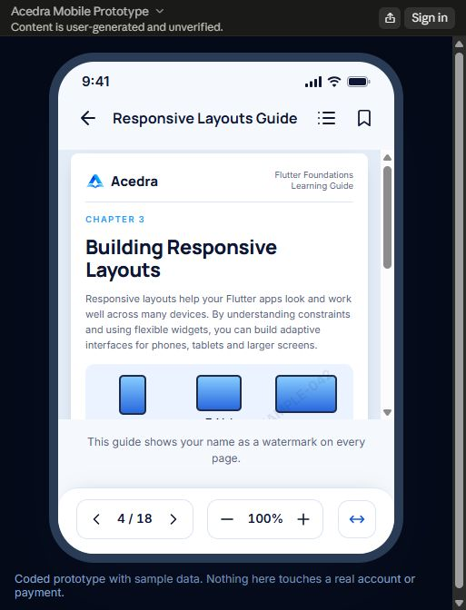
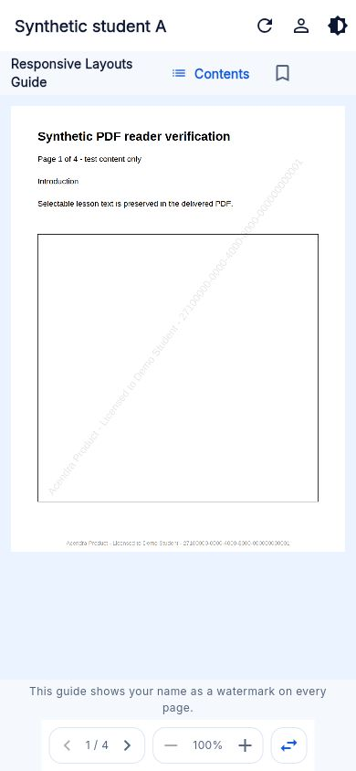
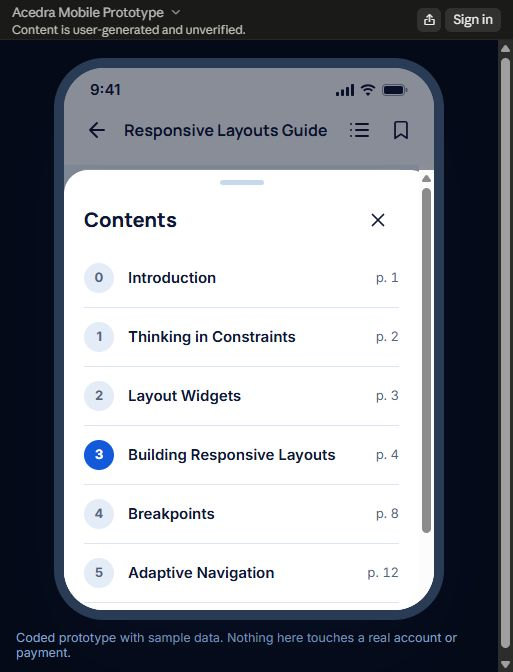
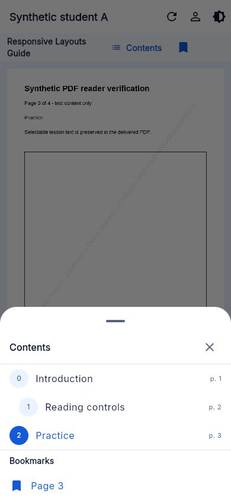
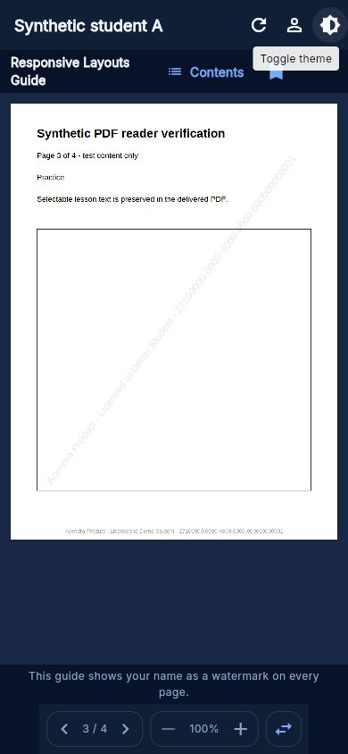

# CSA-271 — COM-020 protected PDF reader

Owner: CODEX. Status: IN_REVIEW. Priority: P1.
Issue: https://github.com/iamramishka/acendra/issues/205
PR: https://github.com/iamramishka/acendra/pull/206 (base dev).
Requirements: COM-020, UI-ST-018, FR-PDF-SEC-005/006, CSA-010.
Branch: feat/csa-271-pdf-reader. Base: dev e4ab889.
Worktree: C:/Users/ramis/.codex/worktrees/csa271-pdf-reader/acendra.
Approval authority: project owner and required maintainer review.

The owner requested implementation, prototype comparison, browser verification,
a PR and integration into dev on 2026-10-21. Follow-up to merged #104 and the
existing contents component; no production release or hosted activation implied.

Writable scope: lib/features/pdf_reader/** and associated tests;
supabase/functions/pdf-content/** and its tests; tool/pdf_watermark/** and
bounded worker/delivery tests; this record; narrow COM-020/D-3 reconciliation
in compare.md. Necessary extensions are recorded on issue #205: same-origin
PDF.js bootstrap/vendor assets, serialized migration 20261021000100, the PDF
entitlement SQL test and worker policy metadata/allowlist. No package/lockfile,
router, global theme, hosted secrets, billing, protections or workflow changes.

Open #201/#202/#204 and worktrees inspected before editing. #202 repeats the
contents component already on dev; this follow-up owns active reader wiring and
backward-compatible additions. The owner authorizes the narrow COM-020 update;
preserve other comparison rows and catalog work in #204. No active PDF owner
overlap identified; previous PDF issue #95 is closed and #104 merged.

Acceptance and verification:
- Preserve backend authorization on every request and derivative-only delivery.
- Preserve approved display-name/opaque-license watermark in actual PDF bytes;
  retain safe internal outlines and reject active/external actions.
- Disclose watermark only after the trusted descriptor confirms ready derivatives.
- Connect contents/bookmarks to the active learning reader; verify page/zoom,
  fit width and user-scoped reading-position restoration including page 1.
- Compare the recorded prototype layout; exact visual parity requires access to
  the reference and a working browser. Local browser control is disabled.
- Run real-byte Python regressions, Node proxy/worker tests, Dart repository,
  state/widget checks, automated Chrome attempt, analyzer/format and web build.

Operational gates from CSA-010 and CSA-140/141/148 remain: confined non-root Linux
worker, trusted licensed locale font, queue/retention, representative renderer
and accessibility acceptance. No raw original/signed-URL fallback. No production
activation without separately verified deployment and release approval.

Merge gate: required CI and review. Existing GitHub Actions account payment/
spending-limit failures are not permission to bypass protections.

## Implementation and compatibility

- Active path remains Learning workspace → ProtectedPdfLesson → authenticated
  descriptor/resource bytes → PdfLessonReader. No original/URL fallback.
- Server descriptor adds `watermark_applied`; disclosure needs strict boolean
  true plus successfully delivered derivative bytes. Older descriptors remain
  readable without disclosure. Existing repository `load()` callers keep their
  byte API; `loadDocument()` adds the trusted display evidence.
- The later owner D-3 answer in compare.md selects Acendra Product + name + ID.
  V2 uses the approved opaque licence ID, not an Auth UUID/email. The worker
  burns a translucent diagonal identity and footer into every page, preserving
  original text, boxes and safe local outline destinations. External/scripted/
  chained actions remain rejected. Unknown policies fail closed.
- Policy UUID 14000000-0000-4000-8000-000000000002 reserves new objects. The
  resolver change is otherwise identical to the existing service-only function.
  A ready v1 resource cannot satisfy v2. Old immutable metadata/objects are not
  rewritten. A supported v1 fixture produces byte-identical output to dev.
- Worker policy comes from its trusted immutable target path, ignoring extra
  policy fields. Supervisor metadata permits only the added policy identifier;
  process bounds remain unchanged.
- Contents/bookmarks, page navigation, 100–300% zoom and actual fit width now
  belong to the active reader. Saved pages/bookmarks are scoped to student and
  lesson, bounded and tolerant of unavailable storage. Saving page 1 replaces
  older progress. The obsolete lesson-only store and global false flag were
  removed. An owned open contents route is removed when its reader disappears,
  including when identity changes before the sheet's first frame.
- Same-origin PDF.js 6.4.299 supplies the runtime previously missing from web.
  Official npm tarball SHA-512 verified; 201 distribution assets have SHA-256
  regression coverage and retained notices. JavaScript filenames use `.js` for
  deployment MIME compatibility. No CSP relaxation or external PDF service.

## Fresh verification evidence

- `flutter test --no-pub --concurrency 1 test/features/pdf_reader --reporter expanded`:
  **128 passed**. Includes chapter/bookmark jumps, zoom/reset matrix, reopening
  position/page 1, student/lesson separation, open-sheet disposal, dark theme,
  and 320/390/768/1440 px at 1×/2× text. Native rasterization is a test boundary;
  these results do not establish browser rendering.
- Pinned `.dart_tool/pdf-worker-venv/Scripts/python.exe -m unittest discover -s tool/pdf_watermark -p test_watermark.py`:
  **15 passed, one non-root Linux-only skip**. CI's existing worker check now
  exercises v1 and v2 through the real Linux supervisor. Locale font packaging
  and deployed filesystem/network confinement remain operational gates.
- `node --test supabase/functions/pdf-content/*.test.mjs supabase/functions/_shared/pdf/*.test.mjs tool/pdf_worker.test.mjs tool/pdf_worker_runtime.test.mjs tool/pdf_assets.test.mjs`:
  **111 passed**. `node --test tool/csa152_pdf_requests.test.mjs`: **34 passed**.
  The older preparing-descriptor expectation was updated to assert the new
  explicit false evidence; authorization/private-field assertions remain.
- PostgreSQL 17 on loopback 55471: **43 ordered migrations applied** to an empty
  disposable database. Both CSA-139 private-storage and CSA-140 entitlement /
  v1-v2 lifecycle SQL suites passed. Synthetic Auth/Storage bootstrap initially
  lacked foldername and real grants/RLS; only the disposable shim was corrected.
  This is not hosted Supabase/Storage acceptance. The database server was stopped.
- Four-page synthetic v2 PDF fixture generated with the production function,
  rendered with bundled Poppler and all pages visually inspected. Marks fit
  the page, original text remains readable/selectable, local chapters survive.
- Scoped analyzer passed with a process-local `DART_DATA_HOME` after the default
  Windows performance-socket cleanup caused SDK shutdown errors. No SDK/global
  configuration changed. Full final analyzer/build outcomes recorded below.
- Changed Dart files are formatted. Full formatting reports **nine pre-existing
  unrelated files** on dev (finance/payment summary, auth/reset forms, dashboard
  hero, continue-learning card, profile provider, settings, learning test).
  They overlap other integration work and were not silently reformatted.

## Browser/prototype result and release gates

Two automated Chrome attempts stalled before the suite loaded;
**zero browser assertions or browser screenshots passed**. The second attempt
ran serially with task-local Dart state. Stopped only the owned test trees.
An earlier concurrent VM attempt exhausted Windows resources; the fresh serial
128-test run passed. The added browser test uses actual bundled PDF.js and
the generated derivative, with synthetic Auth transport only, and is discovered
through the existing Linux `tool:test` job without workflow changes.

CUA inventory reports local browser use disabled in Work settings. The original
reference https://claude.ai/artifact/NDAfFDE3QHzxMNTRXqf4RJ is inaccessible from
the available reader. Comparison used the recorded COM-020 layout and D-3 owner
answer; exact pixel parity and actual reader accessibility remain unverified.

Before adopting the new policy in an approved environment, stop old workers,
install this policy-aware worker, apply the v2 migration and complete approved
font/queue/isolation/retention/renderer/accessibility acceptance. Only then opt
into worker/delivery activation. Hosted delivery remains disabled by default.

PR #202 repeats an older contents component already present on dev. Future
integration must retain CSA-271's active wiring, compatible optional parameters
and owned modal cleanup. Other comparison tasks (including catalog #204) are
preserved. Dev merge remains contingent on actual CI and required review.

## Final handoff

Full `flutter analyze --no-pub`: **no issues**, exit 0 (13.0 s), using the
task-local Dart data directory. Final standard `flutter build web --release
--no-pub`: **passed**, exit 0, **241.2 s**, including Wasm dry run. The existing
Cupertino font-family warning remains. Changed-file formatting and diff hygiene
pass; the nine unrelated baseline formatting failures remain documented above.

Source commits: b7ccfc5 (pinned runtime) and f81308e (reader/server integration).
This final documentation follow-up changes no application behavior or tests.
PR #206 is open and attached to the Codex chat. Its initial Flutter and Supabase
runs 39651751119 / 39651751019 failed before execution: GitHub reports account
payment/spending-limit restrictions. Required review is absent; merge is BLOCKED.
No settings were changed or requirements bypassed. The PR checks tab is the
authority for subsequent heads. Vercel reported success; this does not verify
protected PDF runtime behavior.

Next actions: resolve CI account restriction, integrate the owned baseline
formatting work, obtain required review, and execute the browser test with a
working browser environment. Merge through the protected dev workflow only
after checks/review pass. Complete hosted PDF operational acceptance separately
before activation; no production migration, worker launch or release is claimed.

## 2026-10-22 browser follow-up

The project owner renewed browser verification and artifact comparison. CODEX
continues issue #205 / PR #206 in the same isolated branch. Remote dev is still
e4ab889 and the PR head was d26b578 before this follow-up; no competing PDF
change/review was present. Scope remains the PDF components, associated browser/
widget tests, fixture instructions, this evidence and the COM-020 comparison.

The previously unavailable browser and reference are accessible in this chat.
The reference artifact was inspected directly: compact header, inset PDF page,
disclosure, grouped page/zoom/fit-width controls, and a chapter sheet with round
chapter markers, current selection and explicit Close control. Local changes
bring those details closer to the reference using existing theme tokens, while
retaining the constrained header at large text sizes. No global tokens change.
The synthetic preview uses the actual production PdfLessonReader, PDF.js,
outline parser and browser storage, with the generated four-page v2 fixture.
It is a separate test entry point, not a hosted or production test-data route.

Fresh checks:
- The new Close-contents regression failed for the missing control before the
  fix, then the five contents-sheet tests passed.
- A visual header adjustment caused the existing 320px/200% text test to fail;
  the constrained header was restored. The final serial PDF suite passed
  **129/129**, including all 320/390/768/1440 widths at 100%/200% text.
- The PDF proxy/shared worker/assets/request Node suites passed **145/145**.
- Real-byte watermark Python tests passed **15**, with the existing non-root
  Linux-only supervisor test skipped on Windows (16 discovered).
- Full `flutter analyze --no-pub`: **no issues**, exit 0 (20.5 s). Its initial
  run found one missing-braces lint in the new preview harness; that was fixed.
- Final synthetic preview release build: **passed**, exit 0 (126.2 s), using
  local web resources and the production reader. The existing Cupertino font
  warning remains. This build is separate from the normal application entry.
- Standard `flutter build web --release --no-pub`: **passed**, exit 0 (384.0 s),
  including the Wasm dry run. Only the existing Cupertino font warning remains.
- Final changed-file `dart format --output=none --set-exit-if-changed` check:
  **six Dart files clean**, exit 0. `git diff --check` passed. The nine previously
  documented unrelated full-format baseline failures were not changed.
- The first browser runner attempt did not reach assertions. Overlapping SDK
  compilation hit memory exhaustion; only owned test processes were stopped
  and subsequent SDK work ran serially. No automated Chrome pass is inferred.

Final-build interactive browser observations: actual PDF rasterization and burned
diagonal/footer identity, chapter extraction and page-3 jump, bookmark and its
contents entry, zoom through 300% with the upper control disabled, fit-width
reset to 100%, reopen at page 3, student B starting at page 1 without A's
bookmark, and A restoring its own page/bookmark. Keyboard Close preserved
the reading page. Dark mode kept the original white PDF page readable. Every
control stayed within the viewport at 320/390/768/1440px. Returning to page 1
and fully reloading restored page 1; the reloaded page logged no browser console
errors. **22 assertions passed**, recorded in
[browser-checks.json](CSA-271-PDF-READER/browser-checks.json).
These exercise synthetic local state, not hosted authentication or entitlement.

Selected reference and final-build screenshots are checked in under
`docs/tasks/CSA-271-PDF-READER/`; other viewport captures remain under ignored
`build/pdf-browser-evidence/`. This supersedes the earlier claim that the
reference could not be opened; historical automated-run failures remain above.
Exact document content and phone chrome are reference sample data, not copied
course material. Local browser success does not establish hosted delivery,
representative locale-font/screen-reader acceptance or production readiness.

GitHub's dev protection requires one approval and the Flutter baseline check.
The current check annotation again states that the job was not started because
of account payments/spending-limit restrictions. There are no PR reviews.
These are retained merge gates; no admin bypass or configuration change is
authorized by this follow-up.

Final follow-up status: **IN_REVIEW**. The browser verification gap is closed
for the synthetic local production reader. The automated Chrome run, hosted
operational acceptance, required CI/review and dev merge remain distinct gates.
Owned browser tabs and the loopback preview server were closed after capture.

Reference reader and finished synthetic mobile reader:

Reference contents and finished contents with the saved bookmark:

